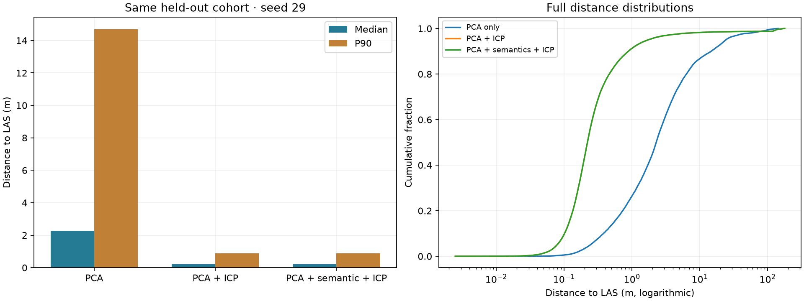

<div align="center">

# Splat2BIM · 0929

**Measure what PCA, ICP and semantic labels actually contribute.**

A single-date research study of 3D Gaussian Splatting registration to LAS,
BIM inspection, and calibrated photo-to-camera-pose estimation.

[Controlled report](results/ablation/inspection.html) · [Results](results/ablation/REPORT.md) · [Pipeline](results/ablation/pipeline.svg) · [Camera experiment](results/camera_localization/REPORT.md) · [Setup](docs/REPRODUCING.md)

</div>



## Controlled experiment

The published study contains **only capture 0929**. It compares:

1. **PCA only** — four proper sign hypotheses, selected by training geometry.
2. **PCA + ICP** — the same PCA pool, geometric selection and robust similarity refinement.
3. **PCA + semantic ranking + ICP** — the same pool and refinement budget, with class-balanced SegFormer label distances added to candidate ranking.

All variants use the same **48,081 held-out Gaussian centers** and LAS reference.
The primary comparison refines one candidate. A **16-setting × 3-seed ablation**
tests candidate budget, semantic weight, confidence filtering, trimming, voxel
resolution, shuffled source labels, and **30 / 200 / 500 iterations per gate**.
No RTK, fitted baseline pose or manual initialization is used in these controlled
fits. The primary cap is 500, with early stopping at the original tolerances.

**Correction:** the earlier 30-step results were iteration-limited. They are
[preserved in the archive](results/ablation_30_iterations/ARCHIVE.md), together
with a new numerical reproduction of their matrices and metrics. The current
report distinguishes a converged terminal update from reaching the iteration cap.

| Primary method | Mean median, m | Mean P90, m | Mean RMSE, m | Terminal convergence |
|---|---:|---:|---:|---:|
| PCA only | 2.278 | 14.703 | 15.321 | N/A |
| PCA + ICP | 0.220 | 0.885 | 15.511 | 2/3 |
| PCA + semantic ranking + ICP | 0.220 | 0.885 | 15.511 | 2/3 |

Values average the per-run metrics over three sampling seeds. Semantic ranking
selects the same final matrices as geometry in the primary comparison and gives
no additional pose benefit here. It does not constrain ICP correspondences.

The geometric branch's mean median is 1.350 m with a 30-step cap, 0.220 m with 200, and 0.220 m with 500. These comparisons keep the fitting samples, distance gates and evaluation cohort fixed.

The full untrimmed cohort retains extreme distances: the low median is not an
error bound for the whole scene, and RMSE remains much larger. Iteration-limited
settings stay in the tables. Numerical convergence is not survey validation. In the primary geometric branch, 2/3 runs reach the terminal tolerance; the other runs remain explicitly flagged.

The report includes every run, stage-by-stage metrics, paired spatial-block
bootstrap intervals, class-label images, candidate traces, and **local/global
4×4 transformation matrices**. The [numerical verifier](results/ablation/verification.json)
recomputes distances and candidate selection, checks every stop reason, and
probes additional terminal updates for stationarity and oscillation.

## What is separate

- **Viewer baseline:** the historical 0929 RTK/COLMAP-assisted full-scene export.
  It is preserved for inspection and has not been replaced by the PCA experiment.
  Its original overlap-filtered median was about 0.219 m. Re-evaluating its saved
  transform on the exact new cohort gives **0.223 m**.
  This is a comparison only; its pose is never supplied to the new fits.
- **BIM:** three IFC revisions are placed in the shared local frame. BIM is not
  used as a target or an accuracy certificate for the controlled registration.
- **Photo-to-camera pose:** SIFT/RootSIFT retrieval and matching, LAS depths,
  EPnP-RANSAC and LM refinement. All 12 historical queries passed the internal
  gate; median camera-center difference from COLMAP was 0.167 m. Reference camera
  poses are inputs; query pose is used only for evaluation.

## Run locally

```sh
python3.11 -m venv .venv
source .venv/bin/activate
pip install -r requirements.txt
npm ci --prefix viewer
python -m unittest discover -s scripts -p 'test_*.py' -v
python scripts/serve_viewer.py
```

Open [the local viewer](http://127.0.0.1:8765/viewer/) or
[the controlled HTML report](http://127.0.0.1:8765/results/ablation/inspection.html).
The report and its figures work without the raw dataset. The viewer requires the
large local scene exports. GitHub displays Markdown; serve the repository locally
to render the HTML report. See [reproduction instructions](docs/REPRODUCING.md).

## Limits

This is one previously explored capture, not an independent new-site test.
Pretrained SegFormer labels and rendering settings were developed previously.
Held-out centers do not enter fitting, but spatial dependence, overlapping
Gaussian footprints, and shared reconstruction photographs remain. LAS is a
reference, not surveyed ground truth. Reported distances are reference agreement,
not certified positional accuracy, segmentation IoU or construction tolerances.
No further dataset is assumed to be available.

## Publication scope

The repository is temporarily private pending GitHub server-side cleanup of its
former history. Rewriting the branch alone does not erase cached old commits.

Only 0929 results and supporting code are published. Raw PLY/LAS/IFC inputs,
photographs, semantic arrays, pretrained weights and full scene exports stay
local. The public history was replaced with this single-date edition; the full
research archive is retained privately on the owner's computer.
