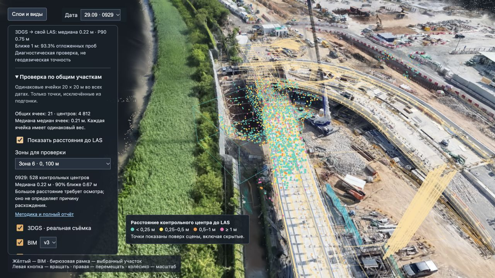
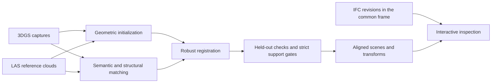

<div align="center">

# Splat2BIM

**Bring construction captures into the same frame as the design.**

Multi-date 3D Gaussian Splatting registration, LAS reference alignment, and BIM inspection.


[Overview](#what-it-does) · [Results](#results) · [Getting started](#getting-started) · [Data guide](docs/DATA.md) · [Research notes](RESEARCH_NOTES.md)

</div>



*Actual local viewer: reconstructed site, BIM overlay, date selection, and distance diagnostics. The current interface and several detailed reports are in Russian.*

## What it does

Splat2BIM aligns existing **3D Gaussian Splatting (3DGS)** reconstructions with supplied **LAS point clouds**, then places **IFC/BIM geometry** in the same coordinate frame. It helps inspect how site observations and the design relate across seven capture dates:

**0331 · 0504 · 0609 · 0708 · 0723 · 0831 · 0929**

The project includes geometric registration, pretrained semantic matching, persistent-structure checks, and an interactive browser viewer. It processes supplied reconstructions; it does not train new 3DGS scenes from photographs.

- **Align full Gaussian scenes.** Transform positions, rotations, scales, and degree-3 spherical harmonics while preserving opacity and point count.
- **Compare dates and BIM revisions.** Switch captures while keeping the camera view; toggle 3DGS, reference LAS, and three IFC revisions.
- **Inspect stable structures.** Evaluate selected roof and riverside regions away from cranes and working equipment, with explicit fit/control splits.
- **Test semantic correspondence.** Compare geometry-based matching with SegFormer predictions on LAS projections and Gaussian-rendered views.
- **Localize photographs.** A separate 12-query experiment estimates camera poses against the site model using image retrieval, feature matches, LAS depth, and PnP-RANSAC.
- **Keep the evidence.** Save transforms, CSV comparisons, protocols, validation receipts, and numerical tests.

## How it works



The 0929 baseline uses RTK image metadata and COLMAP camera poses. The other six captures use geometric initialization; the original 0708 baseline includes a documented visual seed. Later experiments evaluate object, semantic, and persistent-surface initialization separately.

All local outputs use metres relative to **`[825800, 842100, 0]`**. BIM geometry uses this same origin, without a separately fitted BIM transform. See [coordinate conventions](docs/DATA.md#coordinate-conventions).

## Results

| Evaluation | Observed result | Interpretation |
|---|---:|---|
| Multi-date registration | **7 / 7 captures** | Each reconstruction aligned to its own LAS |
| Persistent-structure strict checks | **7 / 7 pass** | Original thresholds retained, including 0708 and 0723 |
| 0929 baseline agreement | **0.219 m median** | Withheld Gaussian centers within shared LAS coverage |
| Reviewed-region refinement | **0.214 → 0.205 m** | 3.9% reduction in the mean of roof/bank control medians across dates |
| Camera localization | **12 / 12 internally accepted** | Median camera-center difference from COLMAP: 0.167 m |
| Numerical test suite | **79 passing tests** | Registration, Gaussian transforms, matching, rendering, and selection |

These are measurements of agreement within the supplied dataset, **not independently surveyed accuracy**. Passing strict checks establishes the required structural support; it does not certify construction tolerances.

### Structural refinement across all seven dates

The table compares the stable-structure parent pose with the optional refinement using manually reviewed roof and riverside regions. Each value is the mean of the two region medians on unchanged, unused control records.

| Capture | Before, m | After, m | Change | Strict check |
|---|---:|---:|---|:---:|
| 0331 | 0.197 | 0.183 | Improved | Pass |
| 0504 | 0.148 | 0.146 | Improved | Pass |
| 0609 | 0.184 | 0.184 | Less than 1 mm | Pass |
| 0708 | 0.279 | 0.266 | Improved | Pass |
| 0723 | 0.221 | 0.201 | Improved | Pass |
| 0831 | 0.218 | 0.209 | Improved | Pass |
| 0929 | 0.247 | 0.247 | Original pose retained | Pass |


**The tradeoff matters:** whole-scene medians increase by 1.7–8.8 mm on the six changed dates, and P90 increases by more than 1 cm on 0331 and 0504. This refinement uses manual region definitions and remains an optional experiment. Its matrices are stored separately; the viewer's full-scene exports were not replaced.

Explore the [per-date CSV](results/reviewed_structural_refinement/summary.csv), [aggregate measurements](results/reviewed_structural_refinement/summary.json), [strict-check comparison](results/stable_structures/summary.csv), and [recorded numerical verification](results/reviewed_structural_refinement/validation.json).

## Getting started

### 1. Install the environment

The recorded development environment uses **Python 3.11 on macOS**, **Node.js/npm** for viewer dependencies, and **`clang++` with C++17** for the Gaussian projection renderer and its tests. Other platforms have not been validated end to end. On macOS, the compiler is available through Xcode Command Line Tools (`xcode-select --install`).

```bash
git clone https://github.com/AsylkhanKali/Splat2BIM.git
cd Splat2BIM

python3.11 -m venv .venv
source .venv/bin/activate
python -m pip install -r requirements.txt
npm ci --prefix viewer
```

The Python file records the development environment's pinned packages, including Open3D, NumPy, SciPy, laspy, IfcOpenShell, OpenCV, PyTorch, and Transformers. Installation depends on compatible wheels being available for your platform.

### 2. Run the numerical tests

These synthetic tests do **not** require the capture dataset or pretrained weights. The Gaussian renderer tests compile a small local C++ library.

```bash
OPENBLAS_NUM_THREADS=4 OMP_NUM_THREADS=4 \
  python -m unittest discover -s scripts -p 'test_*.py' -v
```

### 3. Restore data and generate the local demo

**A Git clone contains code and compact evidence, not the multi-gigabyte scenes.** Supply the original PLY/LAS captures, 0929 photos/COLMAP files, and IFC revisions in the layout described in the [data guide](docs/DATA.md). That guide provides the ordered baseline/export commands and instructions for obtaining the optional semantic weights.

After restoring or generating the viewer outputs:

```bash
python scripts/serve_viewer.py
```

Open **[http://127.0.0.1:8765/viewer/](http://127.0.0.1:8765/viewer/)**. The server listens only on your computer. Select a date, toggle 3DGS/LAS/BIM, and use the quality panel to inspect common areas or stable structures. This is a local application; the GitHub repository does not host a live 3D demo.

## Repository map

```text
Splat2BIM/
├── scripts/             Registration, exports, experiments, reports, and tests
├── viewer/              Three.js + Spark browser viewer and npm lockfile
├── results/             Selected reports, tables, protocols, figures, and transforms
├── models/              Model configurations and pinned provenance; weights excluded
├── starter_code/        Supplied preprocessing utilities, preserved unchanged
├── docs/DATA.md         Input layout, model downloads, and reproduction commands
├── RESEARCH_NOTES.md    Detailed experimental history and method notes
├── PROJECT_STATUS.md    Detailed project status and deliverables (Russian)
├── requirements.txt     Pinned Python development environment
└── .gitignore           Raw data, large outputs, environments, and cache exclusions
```

The [results guide](results/README.md) distinguishes tracked evidence from generated files. Some archived reports link to local artifacts that must be regenerated. Numerical `verify_*.py` scripts require the original inputs and full experiment outputs; stored validation JSON files are receipts from the completed local runs.

## Scope and limitations

- **One site, seven dates.** The methods were developed on this site; transfer to a new site is untested.
- **Reference agreement, not ground truth.** LAS and 3DGS may share source photographs, and Gaussian centers need not lie on physical surfaces.
- **Structural support and pose accuracy are different.** Better labels and surface extraction improved strict acceptance; semantic matching alone did not establish a meaningful final-pose accuracy gain.
- **Manual input is disclosed.** The original 0708 baseline uses a visual seed, and the optional final refinement uses reviewed region definitions. Control records are excluded from fitting, but the same regions remain part of development.
- **BIM is an inspection reference.** The authoritative revision/date mapping and independent horizontal/vertical control remain unconfirmed. Inter-date LAS differences are not automatically corrected.
- **Camera results are internal.** The 12-query localization study assumes known lens calibration and overlap with this site; it does not establish accuracy on arbitrary new photos.

## Acknowledgements and data

Built with [Open3D](https://www.open3d.org/), [COLMAP](https://colmap.github.io/), [IfcOpenShell](https://ifcopenshell.org/), [OpenCV](https://opencv.org/), [Three.js](https://threejs.org/), and [Spark](https://github.com/sparkjsdev/spark). Semantic experiments use the [aerial SegFormer model](https://huggingface.co/Thalirajesh/Aerial-Drone-Image-Segmentation) and [LoveDA SegFormer model](https://huggingface.co/wu-pr-gw/segformer-b2-finetuned-with-LoveDA); exact revisions and hashes are retained in `models/`.

Raw captures, IFC models, and pretrained weights are not distributed here. Obtain them separately under their respective terms. The supplied `starter_code/` utilities retain their original contents and are separate from the project-specific pipeline in `scripts/`.
