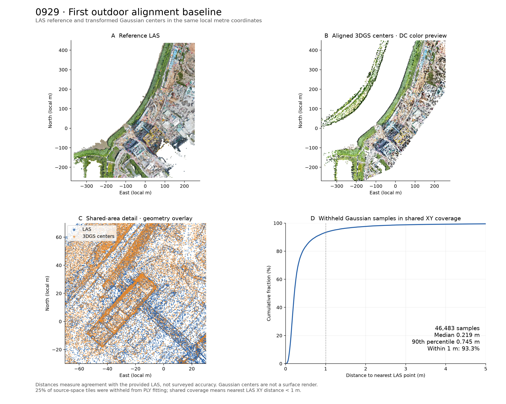

# Outdoor registration — research prototype

Start with [project status and deliverables](PROJECT_STATUS.md). The local demo covers
seven capture dates and a 12-image camera-localization experiment for 0929.

This project aligns an existing 3D Gaussian Splatting scene to the supplied LAS
reference. The reproducible geometric baseline covers **all seven outdoor captures**.
0929 uses drone RTK metadata and COLMAP camera poses; the other dates use geometric
initialization, with a documented visual seed for 0708. Rule-based single-fragment
and spatial-consensus initialization experiments are evaluated separately below.
[Image-to-model camera localization](results/camera_localization/REPORT.md) now has
12 evaluated queries, LAS/BIM overlays and a single-image command.
[Pretrained semantic matching](results/semantic_fusion/REPORT.md) has also been
evaluated on all seven dates. The revised correspondence handling resolves the
0723 rejection, and a building specialist improves some LAS predictions. Final
alignment accuracy is still effectively the same as the current combined method.

[Gaussian-view recognition](results/semantic_3dgs/REPORT.md) now detects 59.8–99.7%
of the sampled control-roof points on all seven dates, compared with zero previously.
These are local development diagnostics, not whole-scene accuracy. The renderer uses
Gaussian covariance, opacity and SH color at 2048 pixels. The existing transforms
remain unchanged: strict failures are explained by nearly collinear support on 0708
and insufficient fragment overlap on 0723. The renderer needs the existing Python
environment and `clang++`, already available on this machine.

[Registration repeated with these labels](results/semantic_3dgs_registration/REPORT.md)
passes the primary filter on 7/7 dates and the strict filter on 5/7, matching the
previous semantic method. Neither 0708 nor 0723 gains strict acceptance. New labels
change the selected seed on four dates, but all final poses remain effectively the
same as the current method; no accepted median change exceeds 1 cm.

Original files in `assets/` and `starter_code/` are unchanged.

[Persistent structural surfaces](results/stable_structures/REPORT.md) now pass
both primary and strict checks on **7/7 dates**, including 0708 and 0723, with
unchanged thresholds. Measured full-color surface growth, infill within original
footprints, and matching across alternative extents recover missing support.
Each physical surface counts once and must persist in at least three LAS dates.
The selected supports on 0708 and 0723 persist in all seven. Final pose accuracy
remains effectively unchanged; this improves structural evidence for the fit.
The previous experiments above remain frozen for comparison.

[Structural accuracy refinement](results/reviewed_structural_refinement/REPORT.md)
uses the existing manually reviewed roof and riverside regions, with fit records
separated from the unchanged controls. The mean of the two control-region medians
across seven dates falls from **0.214 to 0.205 m (3.9%)**, while strict acceptance
remains **7/7**. Five dates improve by more than 1 mm; 0609 changes by less than
1 mm and 0929 retains its pose. This is a local tradeoff: whole-scene medians rise
by roughly 1–10 mm on changed dates, and P90 rises by more than 1 cm on 0331/0504.
New matrices are saved separately; the full working exports remain unchanged.

The next inspection milestone is now available: a local Gaussian renderer with
all three BIM revisions and a reference-cloud toggle. Open
http://127.0.0.1:8765/viewer/ while `scripts/serve_viewer.py` is running. See
[the BIM inspection report](results/0929_bim/BIM_CHECK.md) for measurements,
revision differences, limitations, and restart instructions. The IFC geometry
uses the existing coordinate origin without any additional fitted transform.

## 0929 result: 26 October 2026

The exported scene contains all **2,874,168 Gaussians**. The main validation uses
46,483 sampled Gaussian centers in source-space tiles withheld from PLY fitting,
within the reference cloud's horizontal coverage.

| Agreement with reference LAS | Distance |
|---|---:|
| Median | 0.219 m |
| 90th percentile | 0.745 m |
| 95th percentile | 1.218 m |
| RMS, including remaining outliers | 1.086 m |
| Fraction within 1 m | 93.3% |

These are nearest-neighbor distances to the supplied cloud, **not independent
survey accuracy or guaranteed object-position accuracy**. Gaussian centers are
not necessarily surface samples. The LAS and reconstruction may share source
photographs. Spatial holdout limits direct fitting to the reported samples but
does not make the underlying data independently surveyed.

For all 199,263 filtered Gaussian samples, including regions outside LAS coverage,
median distance is 0.219 m and RMS is 13.429 m. The large RMS reflects a long tail
of non-overlap/outliers; the export retains the entire original scene, including
low-opacity and peripheral Gaussians excluded from diagnostic sampling.



## Files to inspect

Everything is under `results/0929_baseline/`:

- `0929_aligned_local.ply`: transformed Gaussian scene, suitable for a 3DGS viewer.
- `0929_reference_local.ply`: colored reference point cloud in exactly the same
  local frame, suitable for CloudCompare. It is an ordinary point cloud, not 3DGS.
- `alignment_preview.png`: matched top views, a geometry overlay, and error curve.
  The Gaussian panel shows centers and DC color, not a Gaussian-rendered image.
- `alignment.json`: component transforms, coordinate origin, metrics, sampling
  definitions, and limitations.
- `T_3dgs_to_las_local.txt` and `T_3dgs_to_las_global.txt`: 4×4 matrices using
  column vectors, so `p_destination = T @ [x, y, z, 1]`.
- `export_checks.json`: checks against the actual re-opened export.
- `input_manifest.json`: sizes and SHA-256 hashes of the main geometric inputs
  and COLMAP text files (not hashes of all photographs).
- `diagnostics.npz` and `run.log`: intermediate samples and run evidence.

**Coordinate handling:** local output is in metres. Add
`[825800, 842100, 0]` to recover the LAS coordinate values. Both exported PLYs use
this same shift, which avoids storing large survey eastings/northings in float32
Gaussian coordinates. The global matrix already includes the shift; do not add
it twice. An unshifted BIM will not overlay the local outputs directly.

## What the baseline does

1. Match 1,586 available images to COLMAP camera records. Read RTK-fixed positions
   from DJI XMP metadata. Convert WGS84 longitude/latitude to Hong Kong Grid
   using EPSG:2326 as a documented working assumption.
2. Compute COLMAP camera centers with `C = -R.T @ t`. Estimate a similarity using
   1,236 cameras; withhold 350 in distributed contiguous blocks. The withheld
   camera-position residual has median 0.610 m and RMS 0.831 m.
3. Map COLMAP sparse geometry approximately to the LAS. Estimate a vertical
   translation, then refine a rigid transform using trimmed point-to-point ICP.
   Separate spatial tiles are withheld from this refinement. The fitted vertical
   correction is approximately +4.12 m, not a verified geoid/datum conversion.
4. Account for the independently rotated PLY export. Test four proper PCA-axis
   orientation hypotheses, refine by trimmed similarity ICP, and resolve remaining
   scale/sliding ambiguity with robust point-to-plane similarity fitting. The
   final PLY-to-COLMAP scale is approximately 1.000008.
5. Compose the transforms and evaluate unused Gaussian tiles against the LAS.
6. Transform every Gaussian's position, quaternion orientation, log scale, and
   degree-3 spherical-harmonic coefficients. Preserve opacity, DC color, and count.
   Rotation uses the supplied files' standard wxyz quaternion / channel-major SH
   conventions. Numerically test covariance and directional-color preservation.

Gaussian diagnostics use every tenth record, opacity logit > 0, and remove the
outer 0.5% coordinate tails on each axis. Approximately 25% of source-space
0.4-unit checkerboard tiles are withheld from PLY fitting. Reported shared
coverage means the nearest LAS point in XY is within 1 metre. Full definitions
and unrestricted statistics are retained in `alignment.json`.

## Reproduce

Use the existing Python 3.11 environment from this directory. `pyproj` and
`matplotlib` were added to the environment and `requirements.txt`; no system-wide
installation is required.

```sh
.venv/bin/python -m pip install -r requirements.txt
OPENBLAS_NUM_THREADS=4 OMP_NUM_THREADS=4 .venv/bin/python -m unittest discover -s scripts -p 'test_*.py' -v
OPENBLAS_NUM_THREADS=4 OMP_NUM_THREADS=4 .venv/bin/python -u scripts/align_0929.py > results/0929_baseline/run.log 2>&1
OPENBLAS_NUM_THREADS=4 OMP_NUM_THREADS=4 .venv/bin/python scripts/export_3dgs.py
OPENBLAS_NUM_THREADS=4 OMP_NUM_THREADS=4 .venv/bin/python scripts/preview_0929.py
```

The scripts overwrite their own outputs only. On a fresh copy, create
`results/0929_baseline/` before redirecting the log. This baseline is deliberately
specific to the available 0929 inputs; the additional captures use the separate
pipeline described below. Neither is a general-purpose registration package.

Seven numerical tests cover known similarity recovery, rigid ICP recovery, scale
refinement, SH convention, preservation of directional color under rotation,
Gaussian covariance / inverse-transform recovery, and refinement in metre coordinates.
The real PLY is re-opened
and checked after export. The full Gaussian scene has subsequently been viewed
in the local Spark renderer, including BIM overlays at the deck and canopy.

## Remaining checks and next milestone

- **BIM:** all three IFCs declare metres and EPSG:2326, and sampled coordinate
  values are consistent in magnitude with LAS. The LAS projection parameters
  match Hong Kong Grid, but its custom geokeys have zero ellipsoid values and no
  authoritative EPSG code. An initial IFC geometry comparison is now recorded in
  `results/0929_bim/BIM_CHECK.md`. It supports the common coordinate placement
  on inspected structures; independent datum/control checks and the authoritative
  BIM revision remain unconfirmed.
- **Photo completeness:** COLMAP lists 1,759 images; 173 are absent locally.
  The fit uses the 1,586 available RTK-fixed photos.
- **Geometric ambiguity:** large planar areas and repetitive structures can hide
  errors. Add manually identified stable landmarks or surveyed control before
  accepting a construction-monitoring tolerance.
- **Generalization:** the six additional captures now have a geometric registration
  pipeline and date selector (see below). Extend the checks with stable control
  landmarks. The semantic comparison below is a separate experiment; this
  RTK-assisted result is the initial baseline.

Conventions: [COLMAP output format](https://colmap.github.io/format.html),
[reference 3DGS SH convention](https://github.com/graphdeco-inria/gaussian-splatting/blob/main/utils/sh_utils.py).

## All seven outdoor captures

`scripts/align_dates.py` fits 0331, 0504, 0609, 0708, 0723 and 0831 to their own LAS.
Unlike 0929, these folders have no camera/GPS exports. Four proper PCA orientation
hypotheses are refined with uniform-scale ICP and a robust point-to-plane fit.
Spatial tiles are withheld from fitting. Every date uses the origin
`[825800,842100,0]`; the BIM is never fitted to a date.
0708 needs a documented approximate visual initialization because its Gaussian
footprint is smaller than the LAS footprint. The seed is stored in the script;
it is refined on training tiles, with the same held-out evaluation as other dates.
Rejected geometry-only hypotheses and the landmark estimate are retained in its
result folder. No additional image-processing dependency is required.

`results/multidate/REPORT.md`, `comparison.csv` and `comparison.png` compare the
results with the preserved 0929 baseline. Full transformed PLYs, local/global
matrices, source hashes and export checks are stored in each date subfolder.
`scripts/compare_dates.py` compares identical surface samples from BIM v3
with each full LAS. Those distances include hidden faces and different coverage;
they are not a completion percentage or independent survey accuracy.

```sh
OPENBLAS_NUM_THREADS=4 OMP_NUM_THREADS=4 .venv/bin/python scripts/align_dates.py
OPENBLAS_NUM_THREADS=4 OMP_NUM_THREADS=4 .venv/bin/python scripts/export_dates.py
OPENBLAS_NUM_THREADS=4 OMP_NUM_THREADS=4 .venv/bin/python scripts/compare_dates.py
OPENBLAS_NUM_THREADS=4 OMP_NUM_THREADS=4 .venv/bin/python scripts/preview_dates.py
.venv/bin/python scripts/serve_viewer.py
```

At http://127.0.0.1:8765/viewer/, **Date** changes both the Gaussian scene and its
LAS while preserving the camera and BIM revision. Only one Gaussian scene is kept
at a time. The LAS display uses every tenth point; evaluation uses the full LAS.
The default v3 is an inspection reference, not an authoritative revision/date match.

## Common-area quality check: 27 October 2026

The viewer offers **Alignment checks → Shared 20 × 20 m cells**: a colored distance layer and
eight inspection zones. Changing dates preserves the view and updates the points
and statistics. Colors show individual held-out Gaussian-center distances to the
date's full LAS; points intentionally remain visible through other geometry.

`scripts/check_common_areas.py` reproduces the original held-out metrics, then
compares 21 common 20 × 20 m XY cells with at least 50 held-out centers per date.
Every cell has equal weight in the cell-level summary. These cells retain only
10–18% of the previous evaluation samples and can contain different physical
surfaces as construction and coverage change. The seven transforms are unchanged.
The common-cell median of medians ranges from 0.188 to 0.274 m, while some local
tails reach tens of metres; the aggregate score must not hide those regions.

See [the common-area report](results/common_areas/REPORT.md),
[the spatial map](results/common_areas/common_area_map.png), and
`results/common_areas/comparison.csv`. The map colors each cell's P90, whereas
the viewer colors individual points. Neither measure is independent survey accuracy.

```sh
OPENBLAS_NUM_THREADS=4 OMP_NUM_THREADS=4 .venv/bin/python scripts/check_common_areas.py
```

Three additional numerical tests cover grid boundaries, missing/common coverage,
and the distinction between equal-cell and point-density weighting.

## Fixed-structure check: 27 October 2026

The quality panel now offers **Stable structures** as well as the common
grid. Two fixed positive volumes isolate an existing roof and a narrow riverside
structure from the working areas and overhead cranes. Both Gaussian centers and
their LAS reference neighbors are restricted to the same structure. No distance
outliers inside the masks are discarded; no registration is changed.

All seven dates are compared using original PLY indices 5, 15, 25, ... with positive
opacity logits. Fitting used indices 0, 10, 20, ... . This is a record-level check,
not an independent spatial holdout: the old held-out tiles have insufficient
support on these small structures, especially in 0708. Saved source indices make
the change of protocol explicit. Results describe these two volumes only.

The dominant roof surface in LAS 0929 is 0.54–0.86 m above the other LAS dates at
the same XY anchor. Its mask also contains lower points, so this observation does
not establish a global datum correction. Agreement with each date's own LAS must
be distinguished from agreement between dates or absolute BIM accuracy.

See [the fixed-structure report](results/static_structures/REPORT.md), including
the masks reviewed across dates, per-structure metrics and reference-cloud checks.

```sh
OPENBLAS_NUM_THREADS=3 OMP_NUM_THREADS=3 .venv/bin/python scripts/check_static_structures.py
.venv/bin/python scripts/report_static_structures.py
```

## Cross-structure LAS height check: 27 October 2026

A trial vertical correction estimated on the roof worsens the separate riverside
check for 0331, 0504 and 0831. This finding persists across all nine combinations
of XY matching radius (0.20 / 0.35 / 0.50 m) and block size (1 / 2 / 4 m).
The other dates improve in median, without establishing a whole-scene correction.
All 21 unique date pairs are evaluated on both structures; 0929 is a comparison
reference, not surveyed truth. No correction is written to clouds or BIM.

The [height-check report](results/las_vertical/REPORT.md) includes held-out-object
results, reverse checks, 3D residuals, parameter sensitivity and a raw LAS header
audit. Seven input LAS hashes match their previous manifests; 21 registration
files are unchanged. The viewer quality panel links this report.

```sh
OPENBLAS_NUM_THREADS=3 OMP_NUM_THREADS=3 .venv/bin/python scripts/check_las_vertical.py
.venv/bin/python scripts/report_las_vertical.py
```

## Rigid LAS trial with a separate control: 27 October 2026

The [rigid-alignment report](results/las_rigid/REPORT.md) tests three rotations
and three translations without changing scale. A southern riverside strip is
held out of fitting and start selection; the roof/upper building faces and the
middle riverside strip supply the fit. Seven initial positions are evaluated per
date. The report separates training improvement from control performance and
keeps all trial matrices out of the working 3DGS/LAS/BIM alignment.

```sh
OPENBLAS_NUM_THREADS=3 OMP_NUM_THREADS=3 .venv/bin/python scripts/check_las_rigid.py
.venv/bin/python scripts/report_las_rigid.py
```

## Object-guided initialization experiment: 27 October 2026

The [object-alignment report](results/object_alignment/REPORT.md) compares PCA
initialization with raised rectangular surface candidates. One mode searches
both clouds; a second uses one previously reviewed roof ROI in LAS and searches
the original Gaussian scene automatically. New transforms use no camera/GPS
metadata, existing registration matrix or manual 0708 seed. Both experimental
initializers use the same refinement and withheld records.

0929 is the development scene; the reference-roof mode is attempted on all seven
dates with unchanged rules. Missing hypotheses and rejected registrations remain
explicit. An additional check measures whether the selected object patches still
correspond after refinement: a good whole-scene distance does not establish a
correct semantic match. Trial matrices do not replace working exports or BIM.

```sh
OPENBLAS_NUM_THREADS=1 OMP_NUM_THREADS=1 .venv/bin/python scripts/align_objects.py 0929
OPENBLAS_NUM_THREADS=1 OMP_NUM_THREADS=1 .venv/bin/python scripts/align_objects.py 0929 --reference-roof
.venv/bin/python scripts/report_object_alignment.py
```

## Spatial consensus between fragments: 27 October 2026

The [spatial-consensus report](results/object_consensus/REPORT.md) tests whether
several separated surface fragments support the same pose. It compares one-fragment
and multi-fragment initialization using the same candidate pool and ICP budget on
all seven dates. Proposed identities stay fixed during final checks; partial overlap
is measured in both directions. Threshold sensitivity and rejected results remain
visible. This is geometric surface matching, not learned semantic recognition.

New fits use no manually marked reference roof, camera/GPS data, existing transform
or manual 0708 seed. Unseen source records in previously reviewed stationary
roof and riverside volumes provide an additional check without road vehicles or
cranes. The stricter spatial holdout is reported separately, including insufficient
sample counts. Trial transforms do not replace the working exports or BIM placement.

```sh
OPENBLAS_NUM_THREADS=1 OMP_NUM_THREADS=1 .venv/bin/python scripts/align_object_consensus.py 0929 0331 0504 0609 0708 0723 0831
.venv/bin/python scripts/report_object_consensus.py
OPENBLAS_NUM_THREADS=1 OMP_NUM_THREADS=1 .venv/bin/python scripts/verify_object_consensus.py
```

## Pair-distance scale recovery: 27 October 2026

The [scale-recovery report](results/object_recovery/REPORT.md) investigates the
failed correspondences on 0708 and 0723. New starts estimate scale from the spacing
between two surface fragments and require support from other fragments. A broad
scale interval relative to scene extent rejects collapsed solutions; it assumes
comparable coverage of the same site. Correspondences must survive coarse ICP
before a hypothesis is eligible for the protected final selection.

A date-independent selector preserves a previously accepted automatic consensus
result and tries scale recovery only when that method was rejected. Both methods
must pass the training and correspondence checks; otherwise selection fails.
This avoids replacing successful results with the new method's regressions.

The experiment reuses the exact saved fragment sets and control records. It
compares protected selection with a geometric-only control, retains an unbounded
development trial, and checks all seven dates. These are local development and
regression results, not an unseen-site benchmark. Original files, working exports
and BIM placement remain unchanged.

```sh
OPENBLAS_NUM_THREADS=1 OMP_NUM_THREADS=1 .venv/bin/python scripts/align_object_recovery.py 0708 0723 0331 0504 0609 0831 0929
.venv/bin/python scripts/select_object_alignment.py
.venv/bin/python scripts/report_object_recovery.py
OPENBLAS_NUM_THREADS=1 OMP_NUM_THREADS=1 .venv/bin/python scripts/verify_object_recovery.py
```

## Pretrained semantic matching: 27 October 2026

The [semantic comparison](results/semantic_initial/REPORT.md) uses a frozen
SegFormer-B0 drone-image model to label separate top projections of training-only
3DGS centers and LAS. Candidate transforms are scored using distances between
points of the same predicted class. Uncertain, water and movable-class predictions
do not contribute to the semantic score. This does not establish that all equipment
was correctly recognized or excluded from the whole cloud.

Two experiments preserve the geometric refinement and held-out samples. Reranking
after coarse ICP accepts 7/7 dates and produces effectively the same final poses.
Ranking before ICP gives geometry and semantics the same full initial pool and
four-start budget: geometry accepts 5/7, semantics 6/7. Semantics recovers 0504 and
0929 but loses correspondence support on 0723. The current combined automatic
method accepts 7/7 and remains the recommended default. No accepted semantic result
improves the held-out median by more than 1 cm; the fixed-structure checks agree.

The model recognizes almost no confident built structures in the 3DGS projections;
ground and vegetation dominate its usable labels. No semantic ground truth or
independent survey control is available. Frozen protocols, all candidate scores,
rejected fits, source/model hashes and recomputed checks are retained. Working
Gaussian exports and BIM placement are unchanged.

Open the [local comparison](http://127.0.0.1:8765/results/semantic_initial/inspection.html)
or [class maps and first experiment](results/semantic_matching/REPORT.md).
The model files in `models/drone_segformer_b0/` are pinned to repository revision
`fb5d31d4a149b819fade8d79288a9b48f7fa804f`; provenance, preprocessing and hashes
are recorded there and in `results/semantic_matching/segmentation_protocol.json`.
PyTorch and Transformers versions are pinned in `requirements.txt`.

```sh
OPENBLAS_NUM_THREADS=2 OMP_NUM_THREADS=2 HF_HUB_OFFLINE=1 .venv/bin/python scripts/prepare_semantic_clouds.py
OPENBLAS_NUM_THREADS=2 OMP_NUM_THREADS=2 .venv/bin/python scripts/align_semantic.py
.venv/bin/python scripts/report_semantic.py
OPENBLAS_NUM_THREADS=2 OMP_NUM_THREADS=2 .venv/bin/python scripts/verify_semantic.py
OPENBLAS_NUM_THREADS=2 OMP_NUM_THREADS=2 .venv/bin/python scripts/align_semantic_initial.py
.venv/bin/python scripts/report_semantic_initial.py
OPENBLAS_NUM_THREADS=2 OMP_NUM_THREADS=2 .venv/bin/python scripts/verify_semantic_initial.py
```

That milestone had 55 numerical tests. Both semantic reports distinguish nearest
cloud agreement, correspondence support and semantic-label quality.

## Building specialist and 0723 correspondence fix

The [revised comparison](results/semantic_fusion/REPORT.md) adds a LoveDA
SegFormer-B2 building specialist while retaining the drone model's other classes.
Training-only image context is filled across gaps; interpolated pixels never become
3D samples. The previously reviewed LAS roof now receives building labels on five
dates (8–99% of visible roof points), versus none before. The same roof in 3DGS
remains missed on all seven dates. This is a partial improvement on local diagnostic
regions, not a validated whole-scene segmentation model.

The old 0723 rejection came from losing a distant correspondence when choosing
between nearby starts that converge to the same pose. A bank of identities proposed
by initial hypotheses within 2 m RMS is now fixed before ICP. The original scale,
one-to-one matching, overlap and spatial-support gates remain in force. The new
semantic variant and the old-label ablation both pass 7/7 primary checks; both pass
5/7 strict checks. 0723 still fails the strict check. A matched geometry-only control
passes 5/7. No accepted median improves or worsens by more than 1 cm relative to the
current combined method, which remains the default.

Open the [new local report](http://127.0.0.1:8765/results/semantic_fusion/inspection.html)
for all seven dates, class maps before/after, and explicit failure analysis. The
LoveDA model revision and hashes are in `models/loveda_segformer_b2/provenance.json`.
No new Python packages were needed. All 60 numerical tests pass; frozen source
hashes, input identities, scores, gates and control distances are checked by
`scripts/verify_semantic_fusion.py`. Reproduction commands are in the report.
