# Оценка положения камеры по одной фотографии

**0929: 12 из 12 снимков прошли внутренний фильтр качества.** Фотография сопоставляется с опорным набором снимков, затем положение камеры рассчитывается по соответствиям с LAS. BIM остаётся в исходной общей системе координат.

## Протокол

Взяты 12 равномерно распределённых по имени доступных кадров. Они и ±10 соседних кадров исключены из опорного набора; точный состав сохранён в `protocol.json`. Опорные камеры уже откалиброваны через прежнюю матрицу COLMAP → LAS. По ним выбираются видимые глубины LAS и строятся 2D–3D соответствия. Используются SIFT/RootSIFT, поиск пяти опорных изображений по визуальному содержимому, взаимные совпадения с отношением расстояний <0,75, PnP-RANSAC и уточнение LM. Координаты/RTK проверяемой камеры не подаются в поиск или оценку позы. Известные параметры объектива проверяемого фото используются.

Примерно четверть блоков изображения 150 × 150 пикселей исключена из PnP и LM. Для принятия нужны ≥25 обучающих inliers, доля inliers ≥20%, ≥10 контрольных соответствий, ≥35% контрольных совпадений ближе 3 пикселей, площадь выпуклой оболочки inliers ≥5% кадра и положительная глубина. Порог 3 пикселя задан на изображении 1200 × 900, а не на оригинале 4032 × 3024. Полная медиана ошибки контроля включает ложные соответствия.

Все 12 результатов публикуются, включая отказы. Параметры и критерии установлены перед первым запуском этой серии. Это исследовательский опыт на уже известной площадке. Отложенные фото могли участвовать в построении исходного LAS/COLMAP; расстояние до камеры COLMAP измеряет согласованность с тем же проектом и не является независимой абсолютной точностью. Блоки одного фото тоже не независимы статистически.

## Результаты

| Снимок | Решение | Соответствия / inliers | Контроль ≤3 px | Δ центра к COLMAP, м | Δ поворота, ° |
|---|---|---:|---:|---:|---:|
| 1 | кандидат | 607 / 384 | 88% | 0.114 | 0.031 |
| 2 | кандидат | 728 / 511 | 74% | 0.117 | 0.036 |
| 3 | кандидат | 922 / 588 | 89% | 0.152 | 0.045 |
| 4 | кандидат | 794 / 531 | 90% | 0.190 | 0.052 |
| 5 | кандидат | 1244 / 847 | 94% | 0.119 | 0.037 |
| 6 | кандидат | 652 / 442 | 82% | 0.258 | 0.104 |
| 7 | кандидат | 740 / 399 | 91% | 0.336 | 0.155 |
| 8 | кандидат | 202 / 84 | 68% | 0.486 | 0.212 |
| 9 | кандидат | 1045 / 768 | 91% | 0.202 | 0.059 |
| 10 | кандидат | 527 / 303 | 93% | 0.135 | 0.072 |
| 11 | кандидат | 1755 / 1210 | 94% | 0.058 | 0.050 |
| 12 | кандидат | 411 / 249 | 85% | 0.181 | 0.103 |

## Наложение на фотографию

Бирюзовые точки: прореженный LAS без полного расчёта перекрытий поверхностей. Жёлтые линии: рёбра BIM v3 в рассчитанном ракурсе, включая скрытые конструкции. Объективная дисторсия применяется к проекциям; исходная фотография не выпрямляется. Вариант BIM v3 выбран для иллюстрации, его актуальность на дату 0929 не подтверждена. Качество совпадения с BIM не входит в фильтр камеры. Каркас не является маской построенных объектов; несовпадение может быть связано с состоянием стройки, версией проекта или ошибкой привязки.

### Снимок 1: DJI_20260929091641_0042_V.jpeg

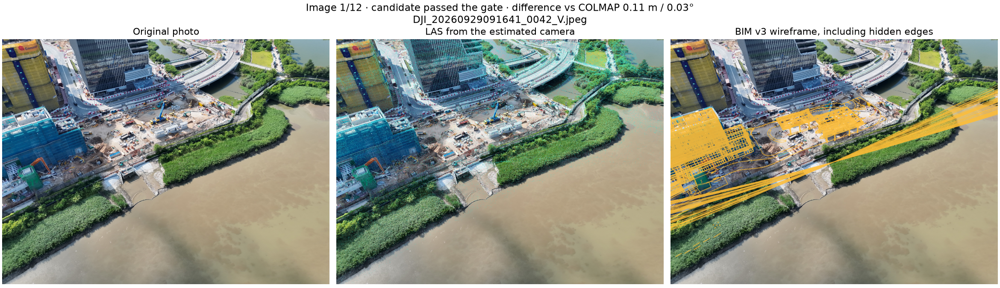

### Снимок 2: DJI_20260929091902_0178_V.jpeg

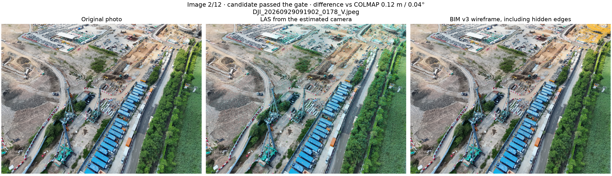

### Снимок 3: DJI_20260929092113_0315_V.jpeg

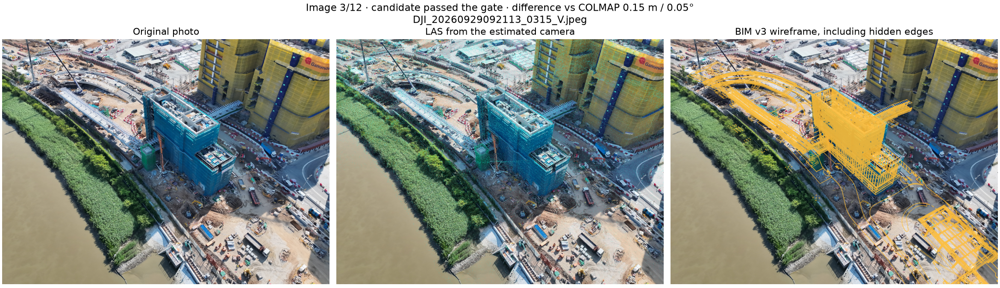

### Снимок 4: DJI_20260929092317_0452_V.jpeg

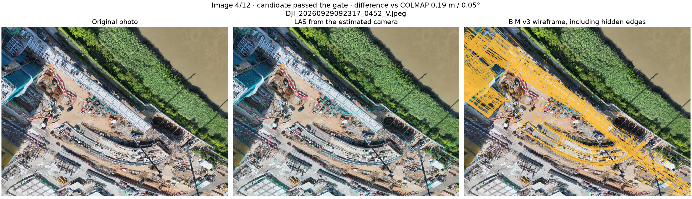

### Снимок 5: DJI_20260929092506_0589_V.jpeg

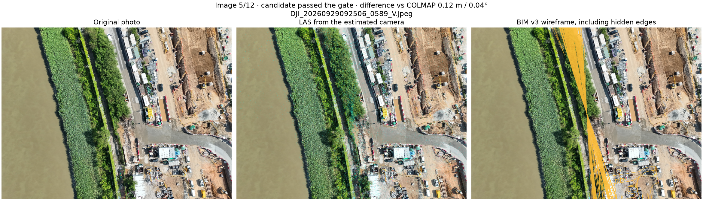

### Снимок 6: DJI_20260929092710_0726_V.jpeg

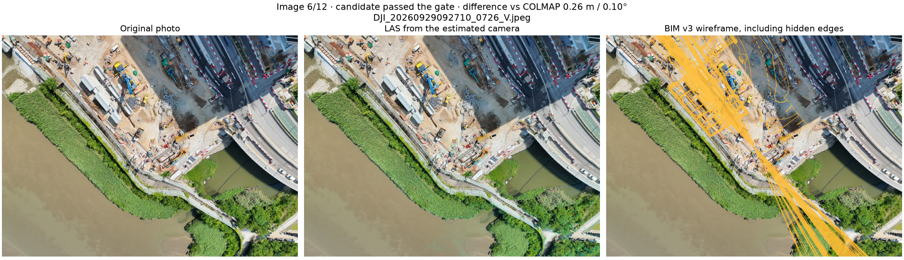

### Снимок 7: DJI_20260929092906_0863_V.jpeg

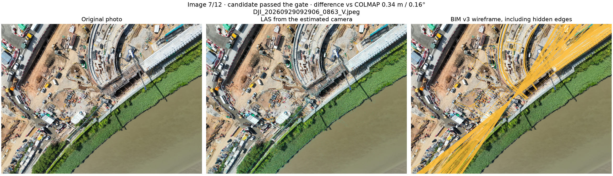

### Снимок 8: DJI_20260929093111_1000_V.jpeg

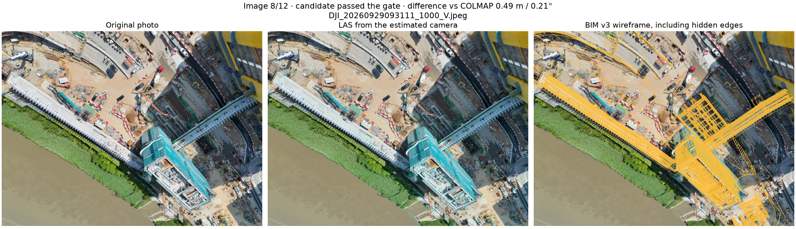

### Снимок 9: DJI_20260929093325_1137_V.jpeg

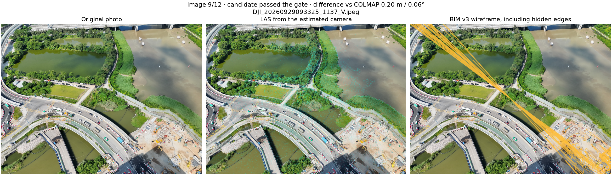

### Снимок 10: DJI_20260929093550_1274_V.jpeg

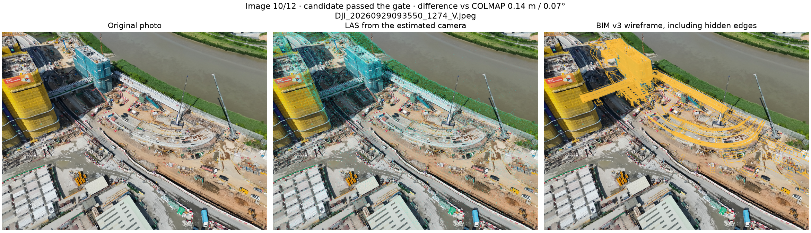

### Снимок 11: DJI_20260929093957_1411_V.jpeg

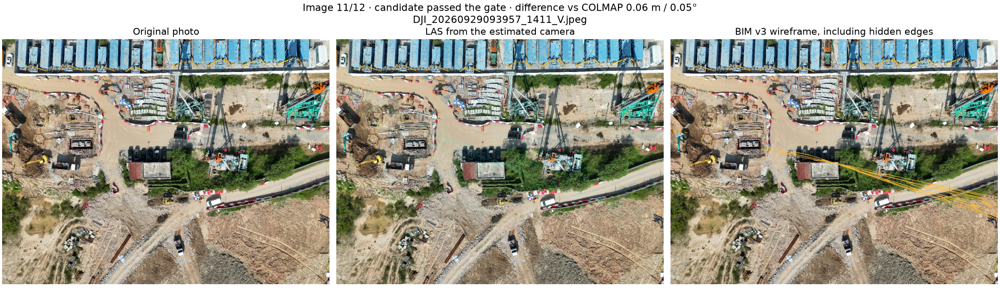

### Снимок 12: DJI_20260929101456_0136_V.jpeg

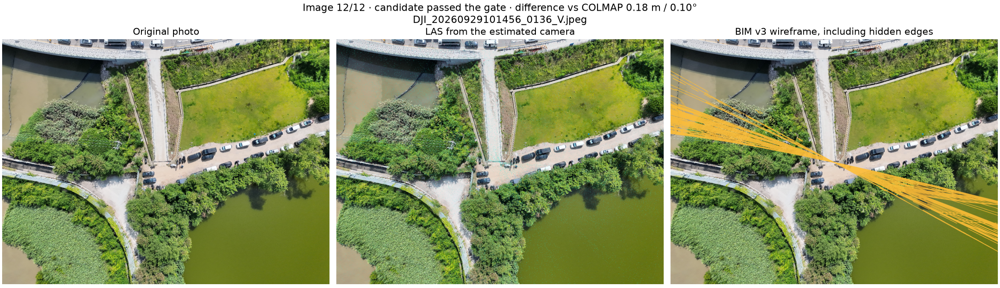

## Файлы и повторение

`poses.json` содержит матрицы world→camera (X вправо, Y вниз, Z вперёд), центры в локальных метрах, K и коэффициенты дисторсии. Локальное начало: [825800, 842100, 0]. `query_*_matches.npz` хранит контрольные/обучающие пары, индексы inliers и ошибки. `inputs.json` и кэш содержат SHA-256 исходных данных и параметров. Статус candidate_for_review означает внутренний допуск к осмотру, а не геодезическую приёмку.

```sh
OPENBLAS_NUM_THREADS=2 OMP_NUM_THREADS=2 .venv/bin/python scripts/run_camera_localization.py
.venv/bin/python scripts/report_camera_localization.py
```

Отдельный снимок можно обработать командой ниже. Примерная калибровка относится только к первому контрольному фото; для другого объектива/снимка нужна его калибровка. Выходной файл должен быть новым. Фото из самого опорного индекса отклоняется, чтобы не выдавать поиск самого себя за локализацию.

```sh
.venv/bin/python scripts/localize_photo.py --image assets/0929/photos/DJI_20260929091641_0042_V.jpeg --calibration results/camera_localization/example_calibration.json --output results/camera_localization/my_pose.json
```

Метод предполагает известные параметры объектива, перекрытие с опорными фото и уже привязанные камеры опорного набора. Данных для такого же опыта на остальных шести датах нет. Перенос на новую площадку, неизвестный объектив и существенно иной ракурс не проверен.

Первичные справочники: [COLMAP: текстовый формат](https://colmap.github.io/format.html), [OpenCV: PnP и LM](https://docs.opencv.org/4.x/d5/d1f/calib3d_solvePnP.html), [SIFT](https://docs.opencv.org/4.x/d7/d60/classcv_1_1SIFT.html).
