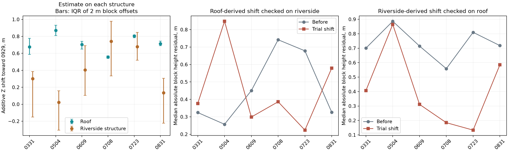
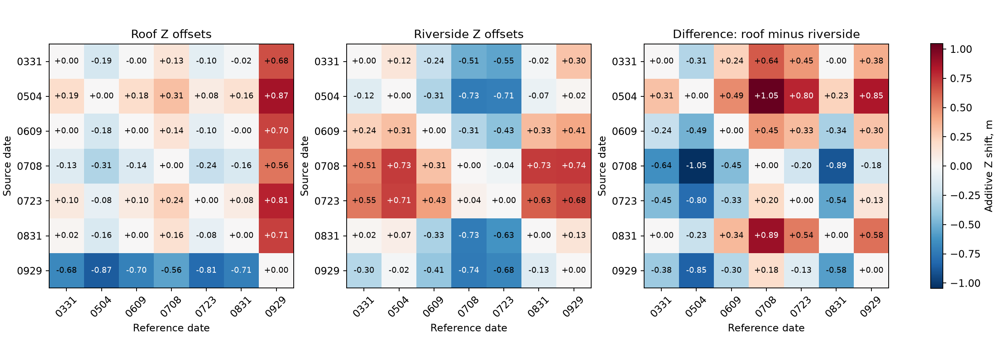

# Can a single elevation correction align the dates?

27 October 2026. The original LAS from all seven dates is checked in two previously fixed control volumes: a roof and a narrow riverside structure. Cranes and equipment access routes lie outside these volumes.

**A roof-derived correction worsens the riverside control on 0331, 0504, 0831.** The result holds for all nine tested XY-radius/block-size combinations. The median decreases on the other three dates, but that does not establish correction of an entire capture. A single vertical correction per cloud is not justified by these two objects.

Trial shifts affect temporary arrays in memory only. Original LAS, 3DGS → LAS matrices, exported clouds, and BIM placement are unchanged. 0929 is a comparison date, **not survey ground truth**.

Follow-up: [rotation/translation with a separate southern control](../las_rigid/REPORT.md), an archived experiment.

## What the check means

If a uniform vertical shift were the only discrepancy, a roof-derived correction should also help another persistent structure. We therefore estimate on one object and test on the other, then swap roles. This tests transfer between objects, not independent survey accuracy.

A positive correction means the source points would be raised toward LAS 0929. The residual is the median absolute height difference across spatial blocks; lower is better.

| Date | Roof correction, m | Riverside correction, m | Riverside residual before → after roof correction, m | Riverside result |
|---|---:|---:|---:|---|
| 0331 | +0.677 | +0.300 | 0.324 → 0.377 | **worse** |
| 0504 | +0.871 | +0.024 | 0.257 → 0.848 | **worse** |
| 0609 | +0.704 | +0.405 | 0.450 → 0.299 | median decreased |
| 0708 | +0.557 | +0.742 | 0.742 → 0.386 | median decreased |
| 0723 | +0.805 | +0.678 | 0.678 → 0.224 | median decreased |
| 0831 | +0.714 | +0.135 | 0.327 → 0.579 | **worse** |
| 0929 | — | — | — | Comparison date; not evaluated against itself |

0504 is particularly informative: the roof suggests +0.87 m and the riverside structure about +0.02 m. Applying the roof correction increases the riverside residual from 0.26 to 0.85 m. On 0609 the median improves slightly, but the height-residual P90 increases from 0.82 to 0.87 m. Improving one median does not imply better overall geometry.



Whiskers on the first plot show the interquartile range across blocks, **not a confidence interval**. The roof has a relatively narrow spread; the riverside structure has a much wider spread.

## Reverse check and 3D distances

| Date | Riverside correction: roof residual before → after, m | Roof correction: symmetric riverside 3D median before → after, m |
|---|---:|---:|
| 0331 | 0.700 → 0.407 | 0.352 → 0.493 |
| 0504 | 0.886 → 0.865 | 0.301 → 0.827 |
| 0609 | 0.715 → 0.311 | 0.419 → 0.405 |
| 0708 | 0.558 → 0.185 | 0.643 → 0.357 |
| 0723 | 0.810 → 0.133 | 0.670 → 0.307 |
| 0831 | 0.718 → 0.585 | 0.352 → 0.615 |

The riverside-derived shift reduces the roof median on all six dates, but the improvement on 0504 is only about 2 cm and the residual remains about 86 cm. This does not establish a universal correction.

The additional check uses the first original point in each 0.25 m voxel. Samples are fixed before trial shifts. Symmetric 3D median means the average of two nearest-neighbor medians: source → 0929 and 0929 → source. Its direction of change agrees with the height check on all six dates. This is agreement between metrics on the same objects, not a new independent observation set. Directional P90 values are retained separately in [cross_validation.csv](cross_validation.csv).

## Parameter sensitivity

All combinations of XY radius 0.20 / 0.35 / 0.50 m and block size 1 / 2 / 4 m were tested. All variants are retained; none was selected as best. The table gives the range of riverside median changes after the roof correction; positive means worse.

| Date | Residual change, m: minimum … maximum | Worse, variants out of 9 |
|---|---:|---:|
| 0331 | +0.052 … +0.196 | 9 / 9 |
| 0504 | +0.591 … +0.696 | 9 / 9 |
| 0609 | -0.190 … -0.135 | 0 / 9 |
| 0708 | -0.423 … -0.355 | 0 / 9 |
| 0723 | -0.526 … -0.455 | 0 / 9 |
| 0831 | +0.134 … +0.355 | 9 / 9 |

[Full sensitivity results](sensitivity.csv). This establishes robustness to these parameters but does not resolve uncertainty about physical-surface selection.

## All pairs of seven dates

All 21 unique date pairs were checked on both objects, giving 42 estimates. Rows are source dates and columns are comparison dates; the reverse half of each matrix is obtained by changing the sign. Diagonal zeros are defined identities, not accuracy tests.



The two estimates also differ substantially in pairs without 0929: for 0504 → 0708 the roof gives about +0.31 m and the riverside structure about −0.73 m. The disagreement is therefore not solely due to choosing 0929 as reference. See [values and support for each pair](pairwise_offsets.csv).

## Reproducible protocol

1. Read the original LAS. Decode coordinates as integer XYZ × scale + offset, then subtract the previous local origin [825800, 842100, 0]. Manual decoding is checked against laspy on 1000 records per date.
2. Apply the identical polygons and height ranges in [regions.json](../static_structures/regions.json) to every date. Masks are not recomputed after trial shifts. Z bounds select the object; there is no error-magnitude filtering.
3. Match mutual nearest neighbors in XY only, within 0.35 m. There is no threshold on Z difference or 3D error.
4. Compute reference Z minus source Z for each pair. Define 2 × 2 m blocks using pair midpoints. Each block needs at least three pairs; the shift is the median of block medians with equal block weights. At least five blocks are required; all 42 estimates meet this threshold.
5. For six dates relative to 0929, test the correction estimated on one object on blocks of the other, without refitting. Control pairs and 3D samples are identical before and after the shift.

The baseline protocol has 90–100 eligible roof blocks and 19–22 riverside blocks per date pair. Total XY-pair counts, mutual-match fractions, and eligible-block counts are saved separately: not every pair falls in a block with three neighbors. NPZ contains all mutual pairs; `matched_blocks.csv` contains only eligible blocks.

## LAS header findings

All seven LAS 1.2 files identify `CaptureReality` as generator; both georeferencing VLRs are byte-identical by SHA-256. Different scale/offset values are correctly decoded. Z quantization is approximately 1.3–1.9 × 10⁻⁸ m, so storage rounding cannot explain discrepancies of tens of centimeters.

Identical metadata does not prove shared actual georeferencing or correct elevations. The headers do not confirm a common vertical datum. LAS format does not make these independent laser or survey measurements. [audit.json](audit.json) preserves header fields, GeoKeys, VLR hashes, and input hashes. All seven LAS hashes match the earlier manifests; 21 registration files remained unchanged during this check.

## Limitations and justified next steps

XY proximity does not guarantee the same physical surface. Visible sides, coverage, and vegetation may differ on the narrow riverside object; the 0929 roof volume includes lower points. A persistent outline does not prove immobility. This check does not determine horizontal shift, tilt, scale, or spatial deformation.

The conclusion is limited to the tested hypothesis: a single roof-derived height correction cannot confidently remove inter-date discrepancies. This neither proves a specific cause nor measures absolute BIM accuracy. Physical correction needs additional distributed support surfaces or identified control points, with georeferencing and vertical-datum checks. BIM should not be fitted separately to each date merely to improve visual overlap.

The previous [3DGS → LAS stable-structure evaluation](../static_structures/REPORT.md) remains separate: agreement with same-date LAS and agreement between LAS dates are different questions.

## Repeat the calculation

```sh
OPENBLAS_NUM_THREADS=3 OMP_NUM_THREADS=3 .venv/bin/python scripts/check_las_vertical.py
.venv/bin/python scripts/report_las_vertical.py
OPENBLAS_NUM_THREADS=3 OMP_NUM_THREADS=3 .venv/bin/python -m unittest discover -s scripts -p "test_*.py" -v
```

Numerical tests check the sign of a known vertical shift and its reverse pair, failure to transfer an incorrect correction to another object, absence of false zero errors with insufficient overlap, and absence of Z-error filtering. The full suite at this experiment stage contained 16 tests.
