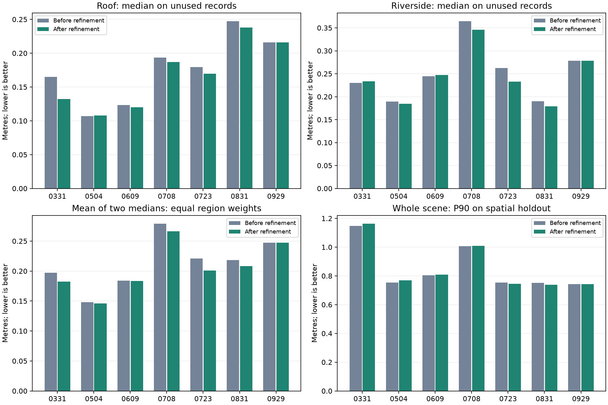

# Accuracy refinement with reviewed stable regions

Mean across seven dates and two regions: 0.214 → 0.205 m (3.9% reduction).

Strict acceptance: 7/7. Accepted corrections: 0331, 0504, 0609, 0708, 0723, 0831. Previous pose: 0929.

| Date | Roof: before → after, m | Riverside: before → after, m | Mean median: before → after, m | Change | Strict supports |
|---|---:|---:|---:|---|---:|
| 0331 | 0.165 → 0.132 | 0.230 → 0.233 | 0.197 → 0.183 | +7.4% reduction | 5 |
| 0504 | 0.107 → 0.108 | 0.189 → 0.184 | 0.148 → 0.146 | +1.2% reduction | 5 |
| 0609 | 0.123 → 0.120 | 0.245 → 0.247 | 0.184 → 0.184 | +0.2% reduction | 7 |
| 0708 | 0.193 → 0.187 | 0.364 → 0.346 | 0.279 → 0.266 | +4.5% reduction | 4 |
| 0723 | 0.179 → 0.169 | 0.262 → 0.232 | 0.221 → 0.201 | +8.9% reduction | 3 |
| 0831 | 0.247 → 0.238 | 0.190 → 0.179 | 0.218 → 0.209 | +4.5% reduction | 5 |
| 0929 | 0.216 → 0.216 | 0.279 → 0.279 | 0.247 → 0.247 | Previous pose retained | 4 |

Whole-scene median increased on changed dates by 1.7–8.8 mm. Dates with a whole-scene P90 increase above 1 cm: 0331, 0504. New matrices are therefore saved separately and do not automatically replace the working exports.

Regions with a median increase above 1 mm: 0331 bank_mid: +3.5 mm; 0609 bank_mid: +2.2 mm.



On the stronger spatial roof holdout, the median decreased on 0331, 0504, 0723, and 0831; it increased by 3.3 mm on 0609. The sample is insufficient on 0708 and 0929. Spatial riverside control samples are insufficient on every date.

## Conditions and limitations

This refinement uses the existing manual definitions of two fixed regions: the roof and riverside structure. It is not a new fully automatic structure detector.

Fitting uses only even original 3DGS records outside the previous spatial holdout tiles. A separate block-based calibration sample within the training data selects the correction. The headline errors use the unchanged records 5, 15, 25…; these participate in neither fitting nor selection.

Region definitions now provide training supervision. Evaluation on different records within the same regions is therefore weaker than evaluation on entirely new structures. Reconstructed Gaussian centers are also not independent survey measurements.

The stronger spatial holdout is retained separately. Roof samples are sufficient only on 0331, 0504, 0609, 0723, and 0831; riverside samples contain fewer than 30 points on every date. Insufficient samples do not count as evidence of improvement.

Scale is fixed. Plane, point, and hybrid fits are tested, followed by the same correction fractions. Selection uses only training and internal block-calibration samples. Whole-scene motion is limited to 0.5 m at fixed bounding-volume anchors.

The previous strict conditions are preserved: ≥3 distinct supports; ≥80% forward and ≥50% reverse overlap within 1 m; support spacing ≥10 m, second axis ≥2 m; center distance ≤5 m, normals ≤20°, size ratio 0.5–2. The pair bank is fixed before refinement; no identities are added after fitting.

The first automatic experiment improved selected supports but worsened the riverside region, by about 9 cm on 0504. The scene-context variant with a no-regression guard on training median/P90 retained the previous poses for all seven dates. Both experiments are preserved; experiments.csv compares them with reviewed-region refinement.

The method was developed on this site with knowledge of earlier control results. This is an experimental comparison, not an independent transfer test. The complete working scenes and BIM in the viewer were not overwritten; new local and global matrices are stored in the date folders.

## Whole-scene evaluation

| Date | Median before → after, m | P90 before → after, m |
|---|---:|---:|
| 0331 | 0.272 → 0.280 | 1.148 → 1.162 |
| 0504 | 0.205 → 0.214 | 0.754 → 0.769 |
| 0609 | 0.253 → 0.258 | 0.805 → 0.809 |
| 0708 | 0.255 → 0.256 | 1.006 → 1.009 |
| 0723 | 0.213 → 0.222 | 0.753 → 0.744 |
| 0831 | 0.234 → 0.241 | 0.752 → 0.739 |
| 0929 | 0.219 → 0.219 | 0.742 → 0.742 |

summary.csv compares the original automatic method and the latest persistent-surface method. static_structures.csv contains errors for both control-sample types; automatic_structural_controls.csv covers additional automatic surfaces. All candidates, including rejected ones, are stored in <date>/fit.json and candidate_comparison.csv.

## Reproduction

```sh
.venv/bin/python scripts/fit_structural_refinement.py
.venv/bin/python scripts/fit_guarded_structural_refinement.py
.venv/bin/python scripts/fit_reviewed_structural_refinement.py
.venv/bin/python -c "import sys;sys.path.insert(0,'scripts');from evaluate_structural_refinement import main;from fit_reviewed_structural_refinement import OUT;main(OUT)"
.venv/bin/python scripts/verify_structural_refinement.py
.venv/bin/python scripts/report_structural_refinement.py
```

Numerical re-verification is recorded in validation.json. The first two experiments have separate results/structural_refinement and results/guarded_structural_refinement directories. All original inputs and previous matrices are preserved.
