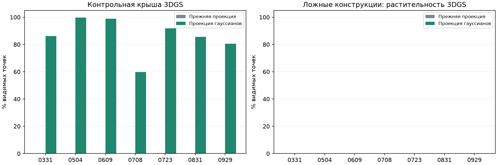
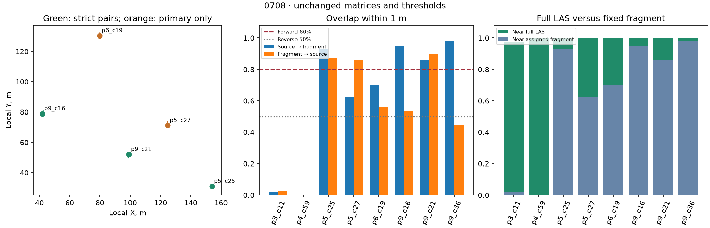
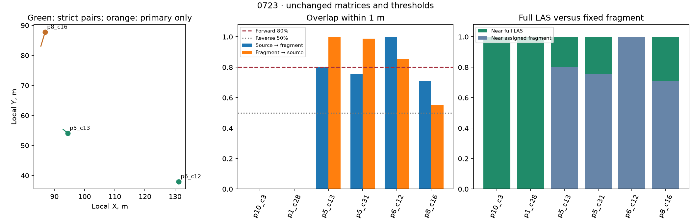

# 3DGS: распознавание конструкций и строгие отказы

В этом опыте улучшено распознавание конструкций в 3DGS. Строгие статусы относятся к прежнему семантическому совмещению: его преобразования и геометрические опоры сохранены. Улучшение распознавания само по себе не доказывает улучшения совмещения.

Контрольная крыша получила метки конструкций на 7/7 датах вместо 0/7. Это доля выбранных видимых точек в одном объёме, не IoU и не точность всей модели.

| Дата | Точек крыши | Крыша: было → стало | Ложные здания в растительности | Пар с достаточным перекрытием | Строгая проверка прежней позы |
|---|---:|---:|---:|---:|---|
| 0331 | 666 | 0.0% → 86.2% | 0.0% | 4 | пройдена |
| 0504 | 1269 | 0.0% → 99.7% | 0.0% | 10 | пройдена |
| 0609 | 1143 | 0.0% → 99.0% | 0.0% | 9 | пройдена |
| 0708 | 888 | 0.0% → 59.8% | 0.0% | 3 | не пройдена |
| 0723 | 1319 | 0.0% → 91.9% | 0.0% | 2 | не пройдена |
| 0831 | 317 | 0.0% → 85.5% | 0.0% | 5 | пройдена |
| 0929 | 284 | 0.0% → 80.6% | 0.0% | 6 | пройдена |



## Что изменено

Прежние разреженные центры с заполненными цветом пробелами заменены ортографическим рендером 3D-гауссианов: проецируются ковариации из масштаба и кватерниона, используется прозрачность с композитингом от дальних к ближним, цвет вычисляется со сферическими гармониками до степени 3. Разрешение увеличено с 1024 до 2048, границы изображения сохранены. Это ортографический вид, а не точное воспроизведение камеры исходного фото.

Модель LoveDA B2, нормализация, плитки 512 пикселей с четырьмя поворотами, порог зданий 0,6 и защита уверенных drone-классов растительности, воды и подвижных объектов сохранены. Новые классы присвоены ровно прежним видимым 3D-точкам; заполненные пиксели не создают геометрию. LAS-метки берутся из прежнего опыта.

Для изображения используются только чётные исходные записи PLY, внутри прежних обучающих границ и вне пространственно отложенных плиток 0,4 исходной единицы. Прозрачные гауссианы с alpha >1/255 сохранены для контекста. Их отпечатки могут пересекать границы исключённых плиток, но центры контрольных гауссианов не читаются рендером. Ни окончательная матрица, ни BIM, ни диагностические объёмы не задают проекцию или прогноз.

**Граница проверки:** разрешение выбрано после исследовательских проб на крыше 0723 и 0929; это этап разработки на известной площадке. Одинаковая конфигурация затем применена ко всем семи датам. Результаты на крыше не являются независимой тестовой оценкой. Изменились одновременно способ изображения и разрешение; их отдельный вклад здесь не измерен. Предыдущая автоматическая матрица используется только для нахождения диагностических объёмов.

[RGB отрицательной области на семи датах](negative_region_review.png). Полоса растительности проверяет один тип ложных срабатываний. Она не оценивает краны, технику, грунт или всю площадку; отдельного класса кранов эта модель не имеет.

## Почему строгая проверка не пройдена

0708: три пары имеют нужное перекрытие, но их центры почти лежат на одной линии. Вторая сингулярная величина центрированных координат источника равна 1,962274 м при минимуме 2 м; для LAS — 4,353667 м. Минимальное расстояние между опорами около 59 м, поэтому проблема именно в поперечном разнесении. Отступ до порога — 3,77 см по этой метрике, не ошибка положения объекта. Порог не снижен.

0723: только две пары удовлетворяют прямому перекрытию ≥80% и обратному ≥50% в пределах 1 м. Третья разнесённая пара p8_c16 → p8_c39 даёт 71,15% / 55,38%: 37 из 52 исходных точек ближе 1 м к назначенному фрагменту, нужно минимум 42. Это нехватка пяти подтверждённых точек, а не предложение добавить искусственные точки.

На обеих датах перебраны все тройки подходящих пар: допустимой тройки нет. Дополнительное сопоставление всех фрагментов в окончательной позе также не нашло её; оно выполнено только для диагностики и не использовано для принятия результата.

Все точки третьей пары 0723 находятся в пределах 1 м от полного LAS, но не все близки к назначенному фрагменту. Это указывает на различия границ/идентичности фрагментов: близость к любому соседу в LAS не подтверждает правильное соответствие объекта. На 0708 у пары p9_c36 → p6_c2 обратное перекрытие лишь 44,52%; 87,2% обратных промахов находятся в отложенных плитках источника. Исключать эти промахи из проверки ради допуска нельзя.

Следующий обоснованный шаг для строгого допуска: на 0708 подтвердить устойчивую опору вне почти прямой линии, на 0723 выделить полные соответствующие части одного объекта. Нужны проверяемые идентичности конструкций, заданные до подгонки; подмена пар после результата или ослабление порогов не применены.




## Файлы и воспроизведение

`summary.csv` — сравнение семи дат; `recognition.csv` — количества в контрольных областях; `<дата>/source_labels.npz` — новые метки исходных 3D-точек и отдельные вероятности LoveDA; `render_context.npz` — исходные индексы контекста; `segmentation_protocol.json` — параметры и хеши; `../strict_diagnostics/` — пары, тройки и пороги. Поле probabilities остаётся прежним распределением drone-модели, building_expert_probabilities хранит новый прогноз LoveDA, labels/confidence/label_origin — итог слияния.

```sh
.venv/bin/python scripts/prepare_semantic_3dgs.py
.venv/bin/python scripts/diagnose_strict_support.py
.venv/bin/python scripts/report_semantic_3dgs.py
.venv/bin/python -m unittest discover -s scripts -p 'test_*.py' -v > results/semantic_3dgs/tests.log 2>&1
.venv/bin/python scripts/verify_semantic_3dgs.py
```

Используются существующие пакеты и веса; нужен clang++ для локального компилятора рендера (на этой машине уже установлен). Предыдущие результаты и исходные assets сохранены. Детали выполненных проверок — в validation.json. [Прежнее сравнение регистрации](../semantic_fusion/REPORT.md).
