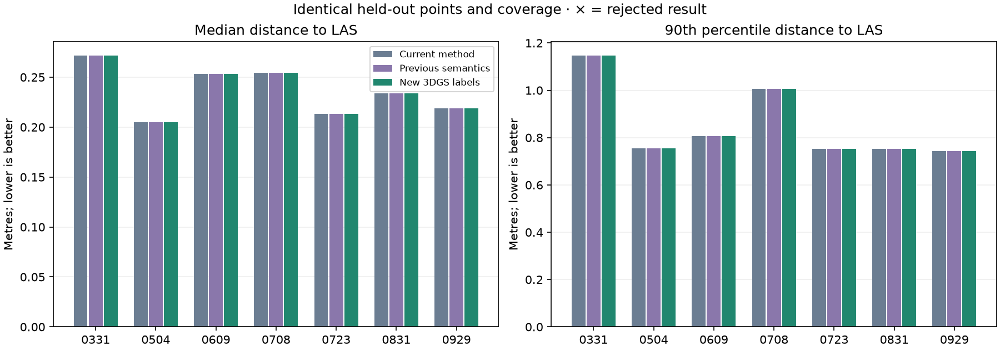

# Registration with new 3DGS labels: seven dates

Current method: primary 7/7, strict 4/7; Previous semantics: primary 7/7, strict 5/7; New 3DGS labels: primary 7/7, strict 5/7.

Among accepted results, median improvements above 1 cm relative to the current method: 0; regressions above 1 cm: 0. Rejected results: no.

## Comparison

| Date | Current median / P90, m | Previous semantic median / P90, m | New-label median / P90, m | New acceptance | Strict: current / previous / new |
|---|---:|---:|---:|---|---|
| 0331 | 0.272 / 1.148 | 0.272 / 1.148 | 0.272 / 1.148 | yes | yes / yes / yes |
| 0504 | 0.205 / 0.754 | 0.205 / 0.754 | 0.205 / 0.754 | yes | yes / yes / yes |
| 0609 | 0.253 / 0.805 | 0.253 / 0.805 | 0.253 / 0.805 | yes | yes / yes / yes |
| 0708 | 0.255 / 1.006 | 0.255 / 1.006 | 0.255 / 1.006 | yes | no / no / no |
| 0723 | 0.213 / 0.753 | 0.213 / 0.753 | 0.213 / 0.753 | yes | no / no / no |
| 0831 | 0.234 / 0.752 | 0.234 / 0.752 | 0.234 / 0.752 | yes | yes / yes / yes |
| 0929 | 0.219 / 0.742 | 0.219 / 0.742 | 0.219 / 0.742 | yes | no / yes / yes |



Rejected results retain their measured errors and are not counted as successes. Distances use identical spatially held-out 3DGS centers and the supplied LAS with unchanged coverage. This is internal agreement, not independent survey accuracy. The 1 cm threshold describes difference magnitude, not statistical significance.

The current method is the previous automatic combined selection. Previous semantics refers to the LoveDA specialist with the neighboring-start pair bank. The third variant replaces only source 3DGS labels with Gaussian-view predictions; LAS labels are unchanged. Historical viewer exports differ from the experimental automatic method and are not replaced.

## Repeat-experiment conditions

For every date, the entire previous hypothesis pool is rescored, four spaced starts are selected, and ICP and final refinement are rerun. Classes, weights, random seed, thresholds, and budget are preserved. Neighboring-hypothesis pairs are fixed before ICP. Previous final matrices are not used as starts; they enter only the comparison after the new fit.

In this implementation, semantics affects start ranking and candidate selection after coarse fitting. Final refinement remains geometric, and strict-check fragments are not re-extracted using the new labels. Better building recognition therefore does not automatically repair support boundaries or spatial distribution.

Primary acceptance retains the scale constraints, training median ≤0.5 m, color difference ≤0.35, and three spaced pairs with ≥50% bidirectional overlap within 1 m. Strict acceptance additionally requires ≥80% forward overlap, support spacing ≥10 m, and a second singular value of centered support coordinates ≥2 m in both scenes. No threshold changed after inspecting the result.

The new labels were developed on this site: this is a controlled variant comparison, not an independent transfer test. Roof and riverside control regions do not select the pose or parameters.

## 0708 and 0723

0708: strict check failed. Pairs with ≥80% forward and ≥50% reverse overlap: 3; valid triples in the initial bank: 0. For the best triple, second spatial axes in 3DGS / LAS are 1.962274 / 4.353667 m against a minimum of 2 m. Diagnostic matching of all fragments at the new final pose gives 3 eligible pairs and 0 valid triples; it does not affect acceptance.

0723: strict check failed. Pairs with ≥80% forward and ≥50% reverse overlap: 2; valid triples in the initial bank: 0. Diagnostic matching of all fragments at the new final pose gives 2 eligible pairs and 0 valid triples; it does not affect acceptance.

0708 has many new building labels in 3DGS, but only 23 in LAS against a 128-point shared-class minimum. Buildings therefore do not contribute to semantic distance on this date. A shared structure class appears on 0723; its presence alone does not guarantee three reliable spatial supports.

All pairs, forward/reverse overlaps, and triples are recorded in `<date>/audit.json` and `strict_diagnostics.json`. All-fragment matching at the final pose is explanatory only and does not add pairs retrospectively.

## Initialization changes

| Date | Previous selected start | New selected start | Shared structure class | Pose displacement vs current, P95, m |
|---|---|---|---|---:|
| 0331 | consensus_16 | consensus_76 | yes | 0 |
| 0504 | recovery_3087 | recovery_3491 | yes | 2.49318e-05 |
| 0609 | recovery_3618 | recovery_3618 | yes | 8.20423e-13 |
| 0708 | recovery_61 | recovery_61 | no | 3.15932e-13 |
| 0723 | recovery_366 | recovery_373 | yes | 0 |
| 0831 | recovery_1141 | recovery_562 | yes | 7.23205e-13 |
| 0929 | recovery_1639 | recovery_1639 | yes | 3.76904e-08 |

Pose displacement is the distance between the same held-out points under two transforms. It separates position change from changes in the supporting-pair set.

## Stable structures

The roof and riverside structure are evaluated in the previous fixed masks excluding cranes and equipment. `static_structures.csv` includes unused-record and spatial-holdout samples, medians, P90, and counts for all three methods. Samples below 30 points are marked insufficient; missing metrics are not converted to zero. Unused-record samples have nearby training points and are weaker than spatial holdouts.

## Reproduction

```sh
OPENBLAS_NUM_THREADS=2 OMP_NUM_THREADS=2 .venv/bin/python scripts/align_semantic_3dgs.py
.venv/bin/python scripts/report_semantic_3dgs_registration.py
.venv/bin/python -m unittest discover -s scripts -p 'test_*.py' -v > results/semantic_3dgs_registration/tests.log 2>&1
OPENBLAS_NUM_THREADS=2 OMP_NUM_THREADS=2 .venv/bin/python scripts/verify_semantic_3dgs_registration.py
```

The previous labels, geometric pools, and models are prerequisites. No new packages or downloads are required once these are restored. `protocol.json` records conditions and code hashes; `validation.json` records numerical re-verification of hypotheses, acceptance, and errors; `summary.csv` contains results; `initialization_changes.csv` records label effects on start selection. See the [previous recognition experiment](../semantic_3dgs/REPORT.md).
