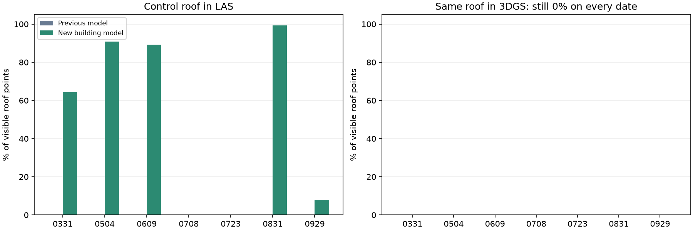

# Семантика: распознавание конструкций и отказ 0723

Текущий комбинированный: 7/7; Прежняя семантика: 6/7; Геометрия + банк пар: 5/7; Прежние метки + банк пар: 7/7; Новые метки + банк пар: 7/7.

Принятых улучшений медианы более 1 см к текущему методу: **0**, ухудшений: **0**. Этот порог описывает размер различия, не статистическую значимость. Рабочий комбинированный метод остаётся основным.

## Сравнение всех семи дат

| Дата | Текущий, медиана / P90, м | Прежняя семантика, допуск | Прежние метки + банк пар, допуск | Новая семантика, медиана / P90, м | Новый допуск |
|---|---:|---|---|---:|---|
| 0331 | 0.272 / 1.148 | да | да | 0.272 / 1.148 | да |
| 0504 | 0.205 / 0.754 | да | да | 0.205 / 0.754 | да |
| 0609 | 0.253 / 0.805 | да | да | 0.253 / 0.805 | да |
| 0708 | 0.255 / 1.006 | да | да | 0.255 / 1.006 | да |
| 0723 | 0.213 / 0.753 | отказ | да | 0.213 / 0.753 | да |
| 0831 | 0.234 / 0.752 | да | да | 0.234 / 0.752 | да |
| 0929 | 0.219 / 0.742 | да | да | 0.219 / 0.742 | да |

Допуск — прежний внутренний фильтр масштаба, геометрии, RGB и минимум трёх разнесённых подтверждённых пар. Отклонённые матрицы, если получены, остаются в CSV с явным статусом. Числа описывают расстояние центров гауссианов до данного LAS на одинаковых пространственно отложенных точках с прежней фиксированной областью покрытия; это не независимая геодезическая точность.

Текущий метод здесь — автоматический выбор из `object_recovery/selection.json`; он отличается от исторических полных экспортов просмотрщика. Ни текущая окончательная матрица, ни RTK, ни ручной старт 0708 не используются для выбора новых стартов.

## Что изменено

1. Добавлен специалист по зданиям: [SegFormer-B2, обученный на LoveDA](https://huggingface.co/wu-pr-gw/segformer-b2-finetuned-with-LoveDA), версия `5c74556c08bebb5f45f50b6f78f61a62c5d220c7`. [LoveDA](https://github.com/Junjue-Wang/LoveDA) содержит отдельный класс зданий на видах сверху. Конфигурация автора задаёт восемь выходов, включая Ignore/Background; используется её нормализация. Код из репозитория модели не исполняется; PyTorch читает только веса через `weights_only=True`, SHA-256 весов проверен.

2. Виды строятся по прежним обучающим точкам. Для изображения пробелы заполняются ближайшим наблюдаемым цветом и медианным фильтром 3×3. В источнике радиус связан с размером отложенной плитки 0,4 исходной единицы; в LAS — 24 пикселя. Это приближение контекста, а не восстановленная поверхность: заполненные пиксели никогда не становятся 3D-точками. Возле границ видны искусственные продолжения текстуры.

3. LoveDA применяется как специалист по зданиям при вероятности ≥0,6. Остальные классы сохраняет прежняя drone-модель. Её уверенные метки растительности, воды и подвижных объектов защищены от замены зданиями. Прежние метки конструкций заменяются новым прогнозом либо неопределённостью. Полная замена всех классов на LoveDA была отброшена из-за отсутствия достаточных общих классов в части пар облаков, до итогового семидатного сравнения. Сырые прогнозы всех дат сохранены в `semantic_structures`; диагностический запуск регистрации 0331 также сохранён.

4. Для каждого выбранного старта заранее объединяются пары, предложенные исходными гипотезами в окрестности RMS <2 м по тем же обучающим якорям. Каждая пара хранит номера предложивших её гипотез. После подгонки допускаются только эти исходные идентичности с прежним взаимно однозначным геометрическим назначением, двусторонним перекрытием и пространственным разнесением. Новые пары из окончательной позы не добавляются.

Все три новых варианта имеют одинаковый пул и бюджет четырёх стартов, одинаковые этапы ICP и финальной подгонки. Контроль «прежние метки + банк пар» отделяет исправление 0723 от новой нейросети. Отложенные ошибки не задают параметры. Это следующий опыт разработки на уже известной площадке, не новый независимый тест.

## Почему отказывал 0723

У прежних геометрического и семантического результатов максимальная разница элементов матрицы была 8,53×10⁻¹⁴: положение практически одинаково. Однако старт `recovery_366` сохранял пять пар, а соседний `recovery_373` — шесть. Среди прежних подтверждённых пар две находятся близко и не дают отдельных пространственных опор.

Банк соседних стартов 558 и 564 добавляет одну заранее предложенную пару `p8_c16 → p8_c39`. В диагностике старой окончательной позы она даёт третью разнесённую опору. Её доли точек ближе 1 м: 71,2% вперёд и 55,4% назад, расстояние центров 4,895 м при лимите 5 м. Это ограниченный запас, а не подтверждение высокой надёжности. `0723_failure_analysis.json` сохраняет все детали.

Строгая проверка минимум трёх пар с прямым перекрытием ≥80%: Текущий комбинированный 4/7, Прежняя семантика 5/7, Геометрия + банк пар 3/7, Прежние метки + банк пар 5/7, Новые метки + банк пар 5/7. Новый вариант всё ещё не проходит строгую проверку на 0708 и 0723. Увеличение числа пар при прежней матрице не означает улучшения точности.

## Проверка распознавания

| Дата | Крыша LAS, старый → новый прогноз | Крыша 3DGS, новый прогноз | Ложные конструкции в растительности LAS |
|---|---:|---:|---:|
| 0331 | 0.0% → 64.4% | 0.0% | 0.0% |
| 0504 | 0.0% → 90.8% | 0.0% | 0.0% |
| 0609 | 0.0% → 89.3% | 0.0% | 0.0% |
| 0708 | 0.0% → 0.0% | 0.0% | 0.0% |
| 0723 | 0.0% → 0.0% | 0.0% | 0.0% |
| 0831 | 0.0% → 99.3% | 0.0% | 0.0% |
| 0929 | 0.0% → 8.0% | 0.0% | 0.0% |



Это доля видимых точек в фиксированных диагностических объёмах, не IoU и не глобальная точность классификации. Использованы ранее проверенная крыша и отдельно осмотренная по RGB полоса растительности без строений. Числа точек и старые/новые метки для обоих облаков находятся в `recognition.csv`. Предыдущая автоматическая матрица используется только для расположения диагностических объёмов в источнике; эти объёмы не читаются сегментацией или регистрацией.

**Улучшение распознавания частичное:** крыша LAS распознаётся на пяти датах, но крыша 3DGS остаётся пропущенной на всех семи. Уверенных меток зданий недостаточно для общего класса на датах 0609, 0708, 0723, 0831. Шумные центры гауссианов и отсутствующие плитки сильно отличаются от снимков, на которых обучена модель. Нужна проверенная разметка и адаптация к этим проекциям либо более качественные виды 3DGS; увеличение числа оранжевых точек не доказывает точности распознавания.

[RGB-проверка отрицательной области](negative_region_review.png). На одной крыше и одной полосе растительности нельзя установить полноту и точность распознавания всей стройплощадки. Модели не имеют отдельного класса кранов. Локальная проверка неподвижных конструкций использует прежние маски исключения техники.

## Неподвижные конструкции и воспроизведение

В `static_structures.csv` сохранены крыша и прибрежная конструкция: отдельные неиспользованные записи и строгие пространственные выборки. Первая выборка имеет соседей в обучении, вторая на узких конструкциях часто мала. Пустые метрики не заменены нулями. BIM и рабочие полные PLY не перемещаются.

```sh
OPENBLAS_NUM_THREADS=2 OMP_NUM_THREADS=2 .venv/bin/python scripts/prepare_semantic_structures.py
OPENBLAS_NUM_THREADS=2 OMP_NUM_THREADS=2 .venv/bin/python scripts/prepare_semantic_fusion.py
OPENBLAS_NUM_THREADS=2 OMP_NUM_THREADS=2 .venv/bin/python scripts/align_semantic_fusion.py
.venv/bin/python scripts/check_semantic_recognition.py
.venv/bin/python scripts/report_semantic_fusion.py
OPENBLAS_NUM_THREADS=2 OMP_NUM_THREADS=2 .venv/bin/python -m unittest discover -s scripts -p 'test_*.py' -v > results/semantic_fusion/tests.log 2>&1
OPENBLAS_NUM_THREADS=2 OMP_NUM_THREADS=2 .venv/bin/python scripts/verify_semantic_fusion.py
```

Требуются сохранённые геометрические пулы и прежние drone-метки. Новых пакетов не добавлено. Веса, параметры и хеши кода зафиксированы до итогового сравнения. `validation.json` содержит численную перепроверку, `http_checks.json` — проверку локальных страниц. [Предыдущий опыт](../semantic_initial/REPORT.md) сохранён.

В файлах `*_labels.npz` поля `labels`, `confidence` и `label_origin` описывают итоговое решение. `probabilities` сохраняет исходные вероятности drone-модели, а `building_expert_probabilities` — прогноз LoveDA; это два отдельных распределения, не единая откалиброванная вероятность нового метода. `label_origin`: 0 — прежний класс, 1 — специалист по зданиям, 2 — прежняя метка здания заменена неопределённостью.
