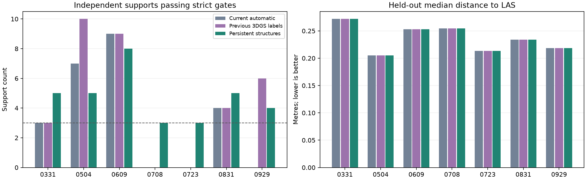
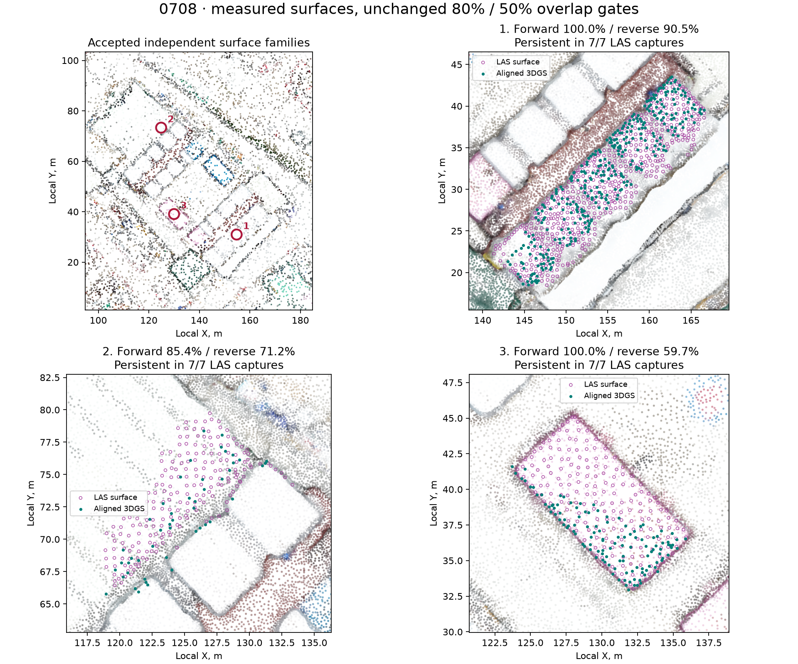
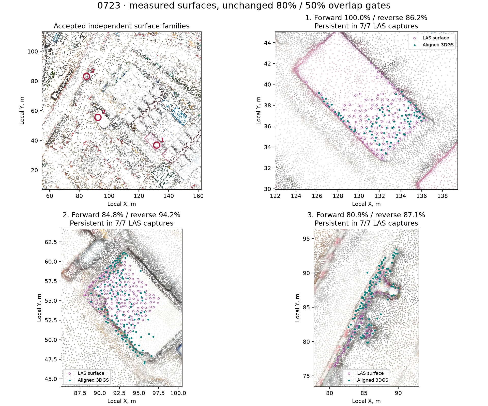

# Persistent structures: repeated strict validation

Current automatic: primary 7/7, strict 4/7; Previous 3DGS labels: primary 7/7, strict 5/7; Persistent structures: primary 7/7, strict 7/7.

| Date | Strict: current / previous / new | New supports | New median / P90, m | Median change vs current, mm |
|---|---|---:|---:|---:|
| 0331 | yes / yes / yes | 5 | 0.272 / 1.148 | +0.0000 |
| 0504 | yes / yes / yes | 5 | 0.205 / 0.754 | +0.0036 |
| 0609 | yes / yes / yes | 8 | 0.253 / 0.805 | -0.0000 |
| 0708 | no / no / yes | 3 | 0.255 / 1.006 | +0.0000 |
| 0723 | no / no / yes | 3 | 0.213 / 0.753 | +0.0000 |
| 0831 | yes / yes / yes | 5 | 0.234 / 0.752 | -0.0000 |
| 0929 | no / yes / yes | 4 | 0.219 / 0.742 | -0.0000 |



0708: strict acceptance passed, supports 3. One accepted triple has 3DGS / LAS second axis: 13.650 / 12.388 m (minimum 2 m); minimum spacing: 25.98 / 26.26 m (minimum 10 m).

0723: strict acceptance passed, supports 3. One accepted triple has 3DGS / LAS second axis: 13.123 / 11.698 m (minimum 2 m); minimum spacing: 32.93 / 28.60 m (minimum 10 m).

## What changed

Surfaces are extracted independently in 3DGS and LAS. Connected planar surfaces of all colors and measured infill within the original footprints supplement the earlier white fragments. No points are synthesized; neighboring planes and confident vegetation, water, and moving-object labels are excluded from growth.

All extents of one physical surface belong to one family. Only one correspondence per family in each scene can count as support. All pairs within the existing geometric gates are retained so that the nearest center cannot displace the correct match. The identity bank is fixed from initial hypotheses before ICP; no new pairs are added after fitting.

A target support must also have at least 80% of its points within 1 m of LAS from at least three dates, including its own. This check uses the supplied shared LAS frame, not the 3DGS transforms. It provides persistence evidence rather than guaranteed classification: stationary equipment could also persist between dates.

All numerical thresholds are unchanged: center distance ≤5 m, normals ≤20°, size ratio 0.5–2; at least three supports, spacing ≥10 m, and second axis ≥2 m in both scenes. Overlap within 1 m must be ≥80% forward and ≥50% reverse. The training-median limit of 0.5 m, color-difference limit of 0.35, and scale limits are preserved.

All seven dates use the same rules, the same initial hypotheses, and four starts. Start scores come from the verified, unchanged Gaussian-label experiment; ICP and final refinement were run again. Previous final matrices enter only the comparison after fitting.

Maximum P95 pose displacement relative to the current method: 2.49318431e-05 m. Independent surfaces provide stronger support for the alignment; these results do not show a meaningful geometric accuracy gain.

Held-out points and fixed coverage are identical for all three methods. The roof and riverside structure are also checked in the previous masks excluding cranes and equipment; static_structures.csv includes both control samples and their counts. These control regions do not select parameters or poses.

This is development and internal evaluation on one site. Strict acceptance is not independent survey certification. BIM and the working viewer exports were not rebuilt: the experiment checks 3DGS → LAS, while the existing LAS → BIM placement is preserved.

Less successful variants were also tested: surface growth alone lost useful original extents, and temporal matching of extracted fragments alone was sensitive to clipping. These diagnostic experiments are retained in results/structural_surfaces. Final numerical thresholds were not tuned on held-out errors.

## Inspected supports





Exact pairs, point counts, and persistence dates: support_pairs.csv. All alternatives, initial banks, overlaps, and triples: <date>/audit.json. Thresholds and hashes: protocol.json and extraction_protocol.json. Numerical re-verification: validation.json.

## Reproduction

```sh
.venv/bin/python scripts/prepare_stable_structures.py
.venv/bin/python scripts/align_stable_structures.py
.venv/bin/python -m unittest discover -s scripts -p 'test_*.py' -v > results/stable_structures/tests.log 2>&1
.venv/bin/python scripts/verify_stable_structures.py
.venv/bin/python scripts/report_stable_structures.py
```
