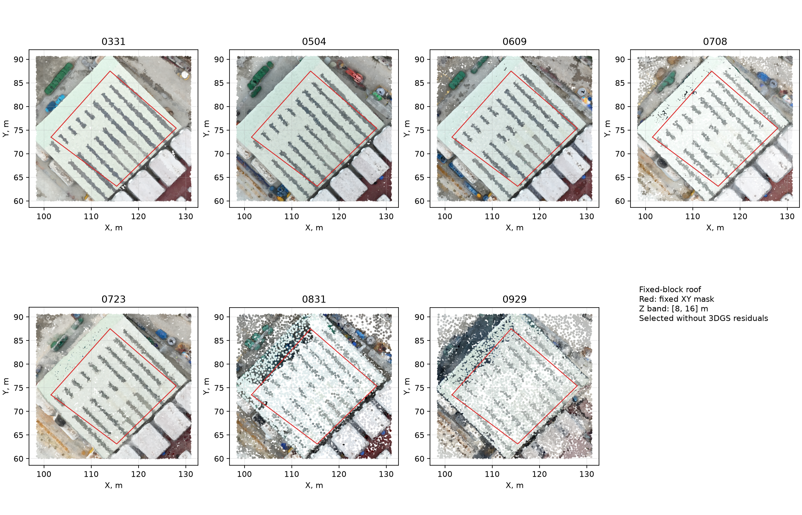
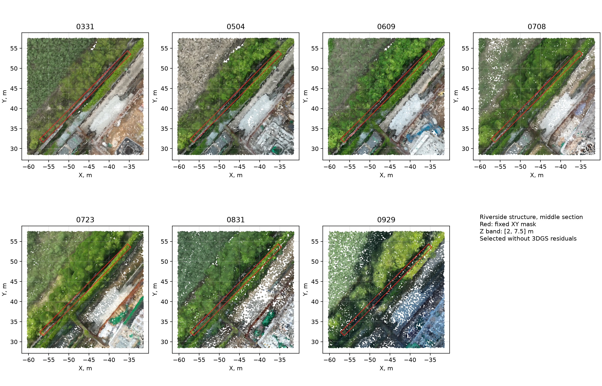
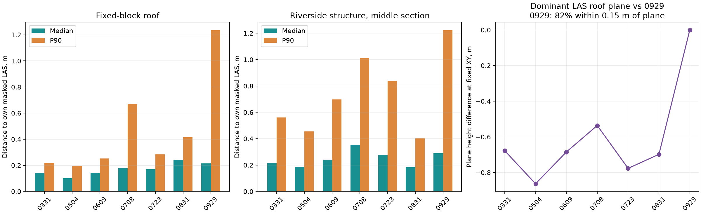
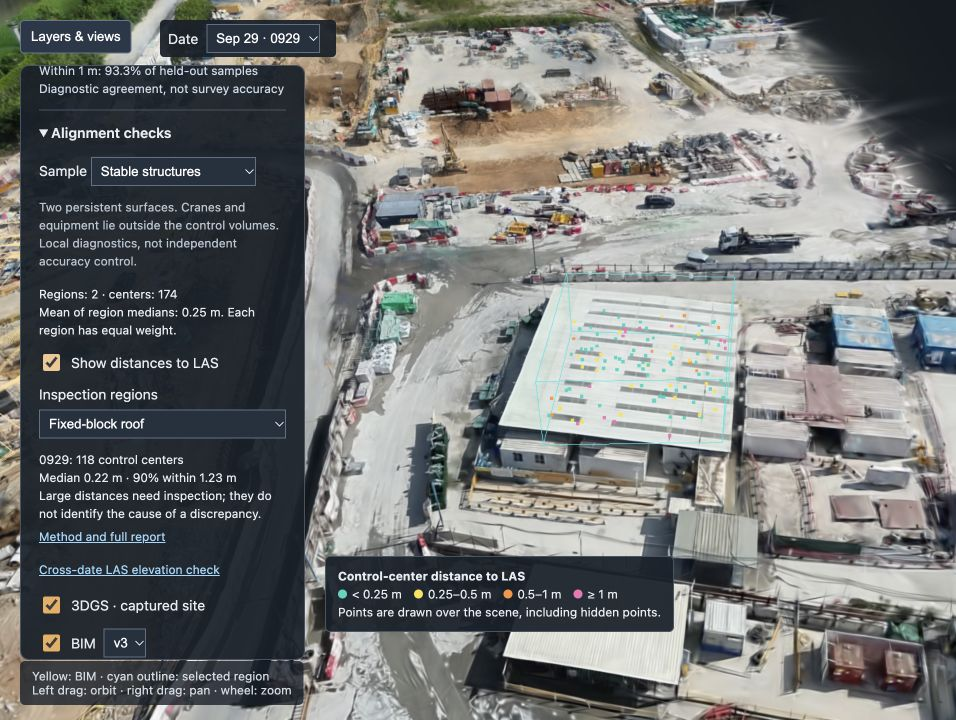
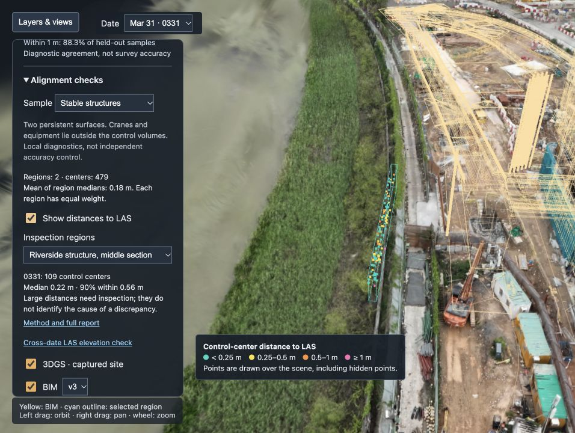

# Alignment checks on stable structures

27 October 2026. All seven dates are compared in two identical control volumes. The 3DGS → LAS transforms and BIM placement are unchanged. Cranes and construction equipment are excluded by choosing surfaces outside work areas and restricting height. This is local diagnosis using manually reviewed masks, not automatic semantic cleaning of the whole scene.

## Evaluation regions

1. The inner white roof of an existing block on the east side of the site. Its outline is recognizable in all seven LAS clouds. The mask stays inside the roof edge and excludes roads, parking areas, and neighboring canopies; its height range is 8–16 m.
2. A narrow gray riverside structure near the middle of the site: approximately 31 m long, 1.2 m wide, and 2–7.5 m in elevation. It is separate from the access road and work area. Tall vegetation and objects above it lie outside the selected height range.

Boundaries in `regions.json` are identical across dates and were defined from colored LAS before calculating 3DGS errors. Masks were refined against visible structural boundaries, not alignment error. Broad tree-covered riverside areas, the changing northern edge, cranes, vehicles, excavations, and bridges under construction are excluded.





The red outline shows the XY mask; a height restriction is applied separately. Colored background points include surroundings to help review the selection. Not every displayed background point enters evaluation.

## 3DGS → same-date LAS

Distance is measured from each Gaussian center to the nearest LAS point **inside the mask of the same structure**. The rest of the site is excluded even from nearest-neighbor searches. Large distances inside the mask are not trimmed.

| Date | Centers: roof / riverside | Roof median / P90, m | Riverside median / P90, m | Mean of two medians, m | Change vs 0929, m |
|---|---:|---:|---:|---:|---:|
| 0331 | 370 / 109 | 0.143 / 0.217 | 0.217 / 0.562 | 0.180 | -0.073 |
| 0504 | 478 / 87 | 0.102 / 0.195 | 0.186 / 0.454 | 0.144 | -0.108 |
| 0609 | 405 / 98 | 0.142 / 0.252 | 0.241 / 0.698 | 0.191 | -0.061 |
| 0708 | 240 / 43 | 0.182 / 0.670 | 0.352 / 1.012 | 0.267 | +0.014 |
| 0723 | 444 / 96 | 0.170 / 0.284 | 0.279 / 0.837 | 0.224 | -0.028 |
| 0831 | 228 / 35 | 0.242 / 0.415 | 0.184 / 0.402 | 0.213 | -0.039 |
| 0929 | 118 / 56 | 0.216 / 1.234 | 0.289 / 1.222 | 0.252 | +0.000 |

Both regions receive equal weight. The aggregate is the mean of their medians, not the median of all centers pooled together. P90 is the distance containing 90% of centers in that region.

On this local sample, 0504 has the lowest and 0708 the highest mean of medians. 0929 has a substantial tail, with P90 around 1.23 m on both surfaces. This is not a whole-capture quality ranking. The 0831 riverside region has only 35 control centers, so small date differences should not be overinterpreted.

## LAS clouds also differ between dates

The dominant LAS roof plane is estimated separately using a robust linear height model at a common XY anchor. This is an additional diagnostic and **does not change** either the clouds or the main distance calculation. Robust-fit weights are used only for the LAS plane estimate.

| Date | LAS plane height at anchor, m | Difference from 0929, m | LAS fraction within 0.15 m of plane | P90 LAS deviation from plane, m |
|---|---:|---:|---:|---:|
| 0331 | 10.377 | -0.677 | 100.0% | 0.068 |
| 0504 | 10.192 | -0.863 | 98.0% | 0.096 |
| 0609 | 10.370 | -0.685 | 99.9% | 0.063 |
| 0708 | 10.518 | -0.536 | 98.7% | 0.051 |
| 0723 | 10.278 | -0.777 | 100.0% | 0.052 |
| 0831 | 10.357 | -0.698 | 96.8% | 0.050 |
| 0929 | 11.055 | +0.000 | 82.4% | 2.672 |

The dominant roof surface in LAS 0929 is approximately 0.54–0.86 m above other dates. This difference already exists in the original LAS and is not caused by the 3DGS transform. LAS 0929 also contains many lower points in this volume: about 82% lie within 15 cm of the plane and deviation P90 is 2.67 m, versus roughly 97–100% near-plane points on other dates. The dominant-plane estimate is not an exact whole-cloud offset.

Two regions cannot establish whether discrepancies arise from vertical datum, georeferencing/reconstruction deformation, visible-surface differences, or physical change. A persistent-looking roof outline supports a control hypothesis but is not survey proof of immobility. A single vertical correction from this roof is not justified.

Additional direct LAS-to-0929 distances are in `las_to_0929.csv` (one source LAS point per 0.25 m voxel). Distances from each 3DGS to unchanged LAS 0929 are in `regions_comparison.csv`. They distinguish agreement with same-date LAS from agreement across dates.



Follow-up: [testing a shared LAS elevation correction across dates](../las_vertical/REPORT.md). A roof-derived correction is checked on a separate riverside structure; original transforms remain unchanged.

## Why the control sample changed

The previous evaluation used source-space tiles of 0.4 units. Some dates have almost no sampled centers in those tiles on these narrow structures: both 0708 regions are empty in the earlier subsampled holdout, and the 0929 riverside region is empty. Missing data must not be replaced with zero.

For the seven-date comparison, every tenth original PLY record starting at index 5 is used: 5, 15, 25, and so on. Fitting used indices 0, 10, 20, and so on. Only finite XYZ and opacity logit > 0 are required before applying fixed control volumes. There is no quantile tail trimming, LAS-XY proximity filter, or error-based removal. Indices are saved in NPZ and verified.

These records did not directly enter numerical fitting but have neighboring training records and may share original photographs. This is **not an independent spatial holdout**. `old_spatial_holdout_count` records how many also fall in the earlier holdout tiles; the aggregate does not conceal the protocol change.

Earlier global and shared-cell metrics use different regions and sampling rules. Lower values here cannot be described as improved registration matrices: the matrices did not change.

## What this check establishes

These volumes allow comparison of reconstruction mismatch against same-date LAS without work-site cranes and vehicles. Small distances do not constrain all six degrees of freedom: a flat roof poorly detects along-plane sliding, and a long narrow structure poorly detects along-axis motion. The riverside mask may exclude centers with large transverse offsets, so results are conditional on that narrow volume. Some noise or low vegetation may remain because LAS has no semantic classes.

These are two small regions, not a site-wide evaluation. They are not assigned to specific IFC elements, and their metrics do not establish absolute BIM position. BIM remains in the previous shared frame. Independent control requires confirmed stable landmarks with known coordinates, including identifiable corners and nonparallel surfaces.

## Viewing, files and reproduction

In the [viewer](http://127.0.0.1:8765/viewer/), open Layers & views → Alignment checks → Stable structures, enable distances, and select a region. The cyan outline shows the exact mask volume. Changing dates updates the scene, control centers, and metrics while preserving the viewpoint. Equipment remains visible in the full scene; numerical evaluation uses only colored centers inside the control volumes.

- `regions.json` — unchanged masks and height bounds.
- `comparison.csv`, `regions_comparison.csv` — summary and per-structure results.
- `roof_plane.csv`, `las_to_0929.csv` — separate reference-LAS checks.
- `*_samples.npz` — coordinates, exact distances, original indices, and region membership.
- `*_distances.ply` — colored viewer layer; `*_las.npz` — LAS of selected structures.
- `validation.json` — matrix/mask checksums and reopened-export checks.

```sh
OPENBLAS_NUM_THREADS=3 OMP_NUM_THREADS=3 .venv/bin/python scripts/check_static_structures.py
.venv/bin/python scripts/report_static_structures.py
OPENBLAS_NUM_THREADS=3 OMP_NUM_THREADS=3 .venv/bin/python -m unittest discover -s scripts -p 'test_*.py' -v
```

All seven exports were checked, including disjoint fit/control record indices and unchanged registration files. Numerical tests check exclusion of ground-level and overhead equipment from a defined volume, retention of large in-volume errors, and recovery of a known plane-height difference.




